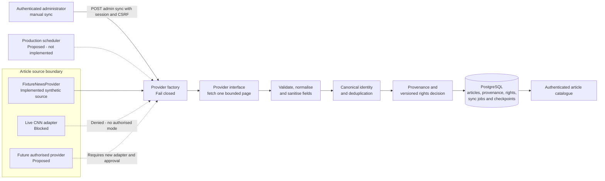
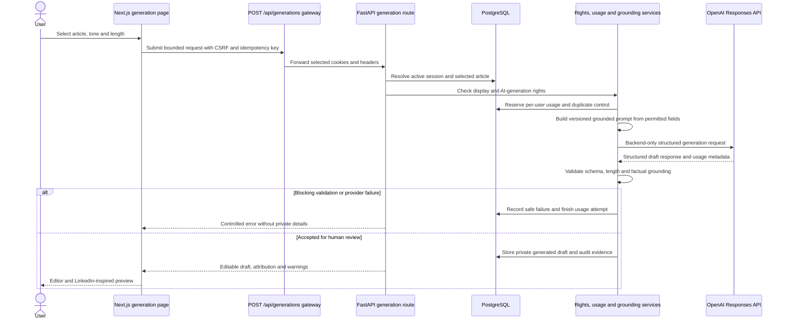
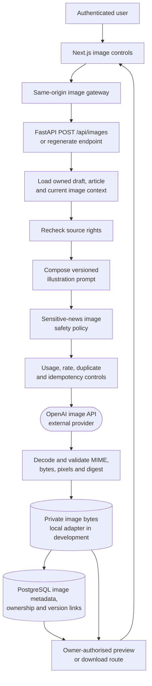
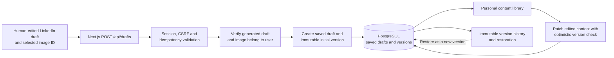
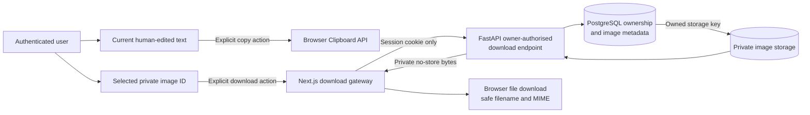
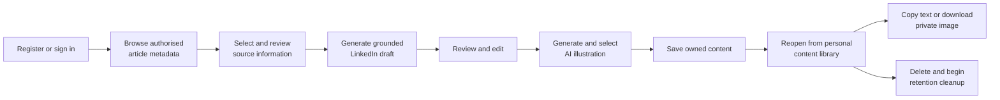
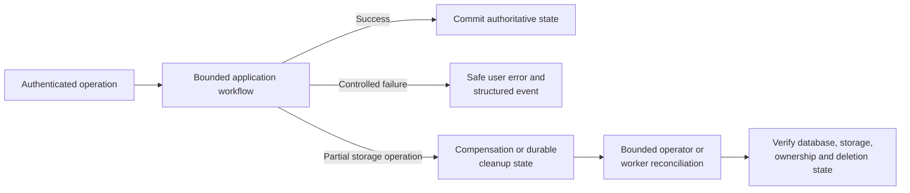

# NewsFlow AI data flows

## 1. Purpose and notation

These Mermaid diagrams show how information moves through the implemented NewsFlow AI workflows. They identify security decisions, persistent records, external calls, and user-visible results.

Notation:

- Solid arrows represent implemented flow.
- Dotted arrows represent a proposed or blocked flow.
- PostgreSQL cylinders represent persistent metadata or records.
- Private image storage represents image bytes, not public URLs.
- Every user-specific flow begins with authentication. State-changing requests also require CSRF proof.

## 2. Article ingestion flow

Implemented behavior:

1. An administrator can request a bounded synchronisation through `POST /api/v1/admin/articles/sync`.
2. The provider factory creates only `FixtureNewsProvider` when `NEWS_SOURCE_MODE=fixture`; otherwise it raises a source-not-authorised error.
3. The provider returns a typed page containing synthetic article records and a checkpoint.
4. Validation permits only the contracted fields and rejects malformed, unsafe, or unpermitted records.
5. Identity and deduplication prevent duplicate articles while allowing reviewed metadata updates.
6. Provenance, attribution, permitted operations, restrictions, and rights validity are persisted with the article.
7. The catalogue returns only current, display-permitted metadata to authenticated users.

The repository contains an article-sync job abstraction, but no production scheduler is configured. Live CNN retrieval is blocked and absent from this flow.

## 3. LinkedIn text generation flow

Important properties:

- The prompt uses only rights-approved article fields and keeps instructions separate from untrusted source text.
- The OpenAI key remains in the FastAPI environment and is never sent to the browser.
- The service requires current rights at the moment of generation.
- Usage limits and idempotency reduce duplicate or uncontrolled paid calls.
- Deterministic validation can block or warn; it does not claim the draft is factually verified.
- Every accepted result requires human review and is never published automatically.

## 4. Image generation and secure delivery flow

Failure rules:

- Rights or safety denial happens before an external provider call.
- Invalid, oversized, corrupt, or mismatched image data is rejected before persistence.
- If byte storage succeeds but metadata persistence fails, the service attempts compensating object deletion.
- A failed regeneration preserves the original image.
- Each successful alternative is immutable and linked to its parent.
- Browser responses never expose a filesystem path or storage key.
- Preview and download routes recheck the authenticated owner and use private no-store responses.
- The implemented storage adapter is local-only. Production object storage is proposed, not implemented.

## 5. Draft saving and content library flow

Implemented behavior:

1. The browser sends the reviewed text, generated-draft ID, optional selected-image ID, CSRF proof, and idempotency key through the Next.js gateway, which forwards the request to FastAPI `POST /api/v1/drafts`.
2. FastAPI verifies that referenced private resources belong to the authenticated user.
3. A PostgreSQL transaction creates the current saved draft and its immutable initial history record.
4. Listing and retrieval always scope queries to the authenticated owner.
5. Updates require the expected version and return a conflict when another update already changed the draft.
6. Restoration never overwrites history; it appends a new current version linked to the historical source.
7. Deletion immediately removes active access and records retryable cleanup and retention work.

## 6. Content export flow

Export is user-controlled. NewsFlow AI does not publish to LinkedIn. Text copying uses the browser Clipboard API and always copies the current edited text. Image download uses an owner-authorised backend request, validates the returned media type and filename, and never reveals the internal storage key.

## 7. Complete user journey

Every step after sign-in remains subject to backend authentication and owner checks. Source display and AI generation also remain subject to current rights. Provider output remains reviewable content, not an automatic publication.

## 8. Data stores and minimisation

| Store or destination | Data | Deliberately excluded |
| --- | --- | --- |
| PostgreSQL | Account email, password hash, hashed sessions, article metadata, provenance, rights, drafts, versions, image metadata, audit and operational records | Plaintext passwords, raw session tokens, image bytes |
| Private image storage | Validated generated image bytes under opaque keys | Public URLs, account credentials, article content |
| OpenAI request | Minimum permitted article facts and controlled instructions required for the selected generation | Database credentials, session tokens, unrelated user profile data |
| Structured logs | Request IDs, safe record IDs, status, duration, category and recovery state | Credentials, cookies, article content, prompts, drafts, provider bodies and private storage keys |
| Browser | Current interface state, edited text and private responses needed for the user's session | OpenAI keys, database credentials, server session secrets and internal storage keys |

## 9. Failure and recovery flow

Database transactions protect related PostgreSQL changes. PostgreSQL and image storage cannot share one transaction, so image workflows use compensation and durable reconciliation. Retrying uncertain paid provider operations is deliberately restricted.

## 10. Verification references

- Article ingestion: `apps/api/app/providers`, `apps/api/app/services/article_sync.py`, and `apps/api/app/services/article_deduplication.py`
- Text generation: `apps/api/app/api/routes/generations.py` and `apps/api/app/services/linkedin_generation.py`
- Image generation: `apps/api/app/api/routes/image_regeneration.py` and `apps/api/app/services/generated_image_storage.py`
- Saved drafts: `apps/api/app/api/routes/saved_drafts.py` and `apps/api/app/services/saved_drafts.py`
- Export: `apps/web/lib/content-export.ts`, `apps/web/lib/image-download-proxy.ts`, and `apps/api/app/api/routes/image_delivery.py`
- Reliability: [reliability-and-recovery.md](../reliability-and-recovery.md)
- Rights: [article-provenance-and-rights.md](../article-provenance-and-rights.md)
