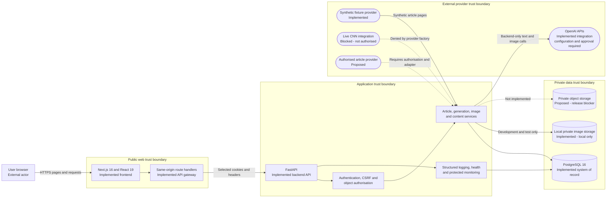
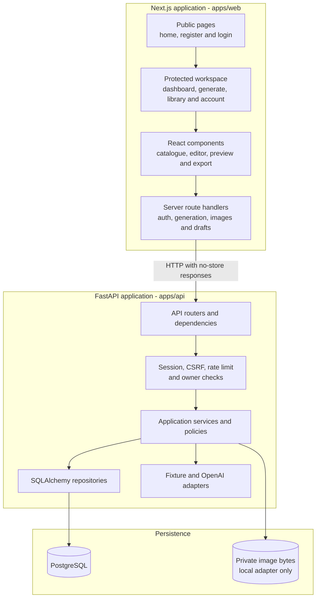
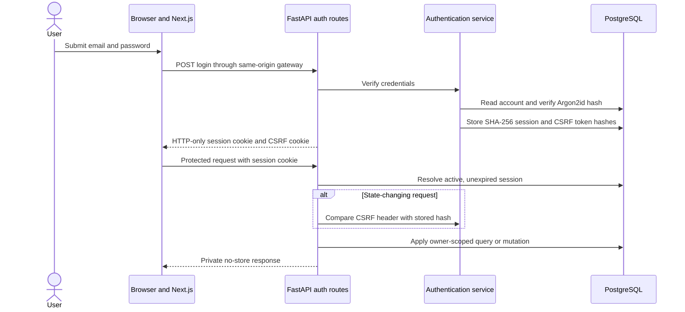
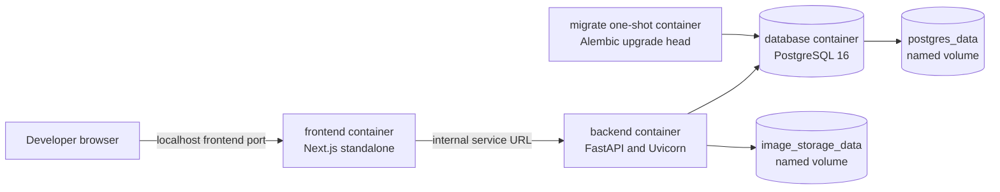

# NewsFlow AI system architecture

## Document control

| Field | Value |
| --- | --- |
| Jira issue | NFA-86 |
| Status | Implemented architecture documented - production deployment remains No-Go |
| Last verified | 2026-11-05 |
| Verification basis | FastAPI application factory, registered routers, Next.js route handlers, PostgreSQL repositories, provider factory, image-storage service, Docker Compose, and NFA-85 deployment documents |

## 1. Purpose

This document explains the implemented NewsFlow AI application structure for developer onboarding, technical review, security review, and portfolio presentation. It separates current components from blocked or proposed integrations.

Status labels used in every diagram:

- **Implemented** - code exists in this repository and is covered by tests.
- **Implemented, configuration required** - the integration exists, but the related feature needs approved server-side configuration before it can make a live request.
- **Local only** - implemented for development and testing, but rejected for staging and production.
- **Blocked** - intentionally unavailable because an authorisation or release gate is open.
- **Proposed** - part of the deployment design, not currently implemented.

## 2. High-level system architecture



### What the diagram means

- The browser renders the Next.js interface and never talks directly to PostgreSQL, private image storage, or OpenAI.
- Next.js route handlers provide a narrow same-origin gateway for authentication, text generation, image generation, draft persistence, deletion, and private image delivery.
- FastAPI is the authoritative security and business-logic boundary. Frontend validation improves usability but does not grant access.
- PostgreSQL stores users, hashed session tokens, article provenance and rights, generated drafts, saved content, version history, image metadata, usage records, and audit evidence.
- Generated image bytes are separate from PostgreSQL metadata. The current local adapter is private and development-only.
- OpenAI text and image service code is implemented and tested with mocks. A live call requires server-only credentials and the applicable deployment approvals.
- The provider factory can create only the synthetic fixture provider. It fails closed for every other source mode.
- A live CNN connection is not part of the implemented architecture and must not be inferred from the product name or conceptual workflow.

## 3. Application component view



The backend follows a route, service, repository structure:

1. Routes validate the HTTP contract and resolve the authenticated session.
2. Security dependencies require a valid session and require matching CSRF proof for state-changing operations.
3. Services implement rights, safety, idempotency, limits, grounding, ownership, retention, and recovery behavior.
4. Repositories perform owner-scoped PostgreSQL access through SQLAlchemy.
5. Provider adapters isolate external services from core application logic and allow deterministic test doubles.

## 4. Authentication and authorisation boundary



Security properties:

- Passwords are hashed with Argon2id and are never returned.
- Random raw session tokens are sent only as cookies; PostgreSQL stores SHA-256 hashes.
- The session cookie is HTTP-only and becomes Secure in staging and production.
- State-changing routes require the active session and matching CSRF proof.
- Object-level checks use the authenticated user ID in repository queries.
- Missing and differently owned private resources use the same safe not-found behavior.
- Administrator routes require an authenticated database-backed administrator role.

## 5. Local Docker architecture



Docker Compose starts PostgreSQL, runs the one-shot migration service, starts FastAPI after successful migration and readiness, and then starts Next.js. Both application containers run as non-root users. Named volumes provide local persistence, not production backups.

## 6. Deployment architecture status

The local Docker view above is implemented. The production view in [the NFA-85 deployment guide](../deployment/deployment-guide.md) is proposed and remains blocked by release gates. A future approved deployment needs:

- HTTPS edge and trusted proxy configuration.
- Managed private PostgreSQL with encryption and tested backups.
- An approved private object-storage adapter.
- Managed secrets, central logs, metrics, alerts, and incident ownership.
- Shared abuse controls and provider spending limits.
- Closed security, UAT, rights, recovery, and accessibility gates.

## 7. Trust boundaries and data classification

| Boundary | Data crossing it | Required controls |
| --- | --- | --- |
| Browser to Next.js | Credentials, preferences, edited text, selected identifiers | HTTPS in deployment, accessible validation, same-origin requests, no browser secrets |
| Next.js to FastAPI | Selected cookies and headers, bounded JSON, image bytes on delivery | Private origin where available, strict gateway allowlists, authentication, CSRF, no-store responses |
| FastAPI to PostgreSQL | Accounts, hashed sessions, article metadata, rights, drafts, audit and ownership | Parameterised queries, private network, least privilege, transactions, encryption and backups in deployment |
| FastAPI to OpenAI | Minimal rights-approved article fields, generation instructions, approved draft context for images | Backend-only key, rights checks, prompt separation, safety policy, timeouts, limits, no secret logging |
| FastAPI to image storage | Validated generated bytes and opaque storage keys | Private access, size and pixel limits, digest, owner-scoped delivery, cleanup and reconciliation |
| Article provider to FastAPI | Provider metadata and permitted content fields | Explicit authorisation, adapter contract, validation, normalisation, provenance, deduplication and rights versioning |
| Operations to protected monitoring | Content-free operational identifiers and measurements | Administrator role, access logging, retention, redaction and no private content |

## 8. External and internal component inventory

| Component | Boundary | Current status |
| --- | --- | --- |
| Next.js, React and Tailwind CSS | Internal web application | Implemented |
| FastAPI and application services | Internal backend | Implemented |
| PostgreSQL and Alembic | Private internal data service | Implemented locally and in CI |
| Local private image adapter | Private internal filesystem | Implemented for development and test only |
| OpenAI text and image APIs | External provider | Integration implemented; live use needs configuration and approval |
| Fixture article provider | Internal deterministic adapter | Implemented with synthetic content |
| Live CNN source | External provider | Blocked and not authorised |
| Future authorised article provider | External provider | Proposed only |
| Production private object storage | External managed infrastructure | Proposed and required before deployment |
| Docker and Docker Compose | Local packaging and orchestration | Implemented for development |
| Managed deployment platform | External hosting infrastructure | Not selected |

## 9. Accuracy references

- FastAPI composition: `apps/api/app/main.py`
- Authentication boundary: `apps/api/app/api/dependencies.py` and `apps/api/app/services/authentication.py`
- Provider selection: `apps/api/app/providers/factory.py`
- Next.js gateways: `apps/web/app/api` and `apps/web/lib/*-proxy.ts`
- PostgreSQL models and repositories: `apps/api/app/database` and `apps/api/app/repositories`
- Private storage: `apps/api/app/services/image_storage.py`
- Docker composition: `compose.yaml`
- Detailed flows: [data-flow.md](data-flow.md)
- Significant decisions: [architecture-decisions.md](architecture-decisions.md)

## 10. Maintenance

Update this document in the same pull request when a major component, trust boundary, provider status, authentication mechanism, storage adapter, or deployment architecture changes. Run:

```bash
python3 scripts/verify_architecture_documentation.py
```

The check verifies required diagrams, current route prefixes, implementation-status language, trust boundaries, README links, and repository evidence paths.
