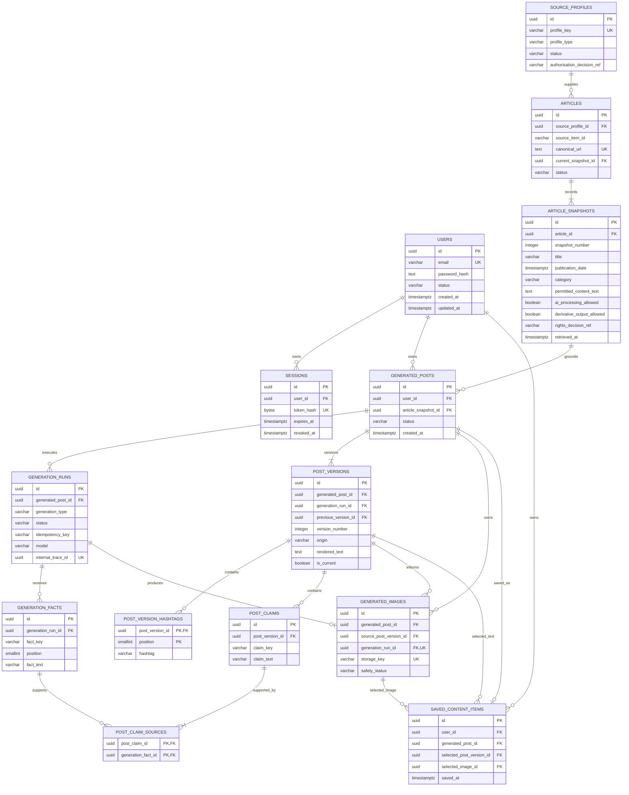

# NFA-20 - PostgreSQL Database Schema Design

## 1. Document control

| Field                 | Value                                                                          |
| --------------------- | ------------------------------------------------------------------------------ |
| Project               | NewsFlow AI                                                                    |
| Jira issue            | NFA-20                                                                         |
| Project-plan task     | T2.1 - Design the database schema                                              |
| Version               | 1.0                                                                            |
| Status                | Technically complete - conditional approval pending the T1.2 architecture gate |
| Created               | 23 October 2026                                                                |
| Owner                 | Mashood Ogunbiyi                                                               |
| Database              | PostgreSQL 16                                                                  |
| Requirements baseline | [NFA-3 - Baseline Requirements and Acceptance Criteria](NFA-3.md)              |
| Source data contract  | [NFA-6 - Source Data Contract](NFA-6.md)                                       |
| Safety review         | [NFA-7 - Privacy, Copyright, and AI Safety Review](NFA-7.md)                   |
| Live-source decision  | [NFA-8 - Live CNN Integration ADR](NFA-8.md)                                   |
| Repository path       | `docs/jira/NFA-20.md`                                                          |

### Revision history

| Version | Date            | Change                                                                                                                              | Author           |
| ------- | --------------- | ----------------------------------------------------------------------------------------------------------------------------------- | ---------------- |
| 1.0     | 23 October 2026 | Designed the MVP PostgreSQL schema, ERD, keys, constraints, indexes, ownership model, normalisation review, and scenario validation | Mashood Ogunbiyi |

### Review and approval position

Mashood Ogunbiyi has authorised and reviewed the preparation of this database design for the current solo project phase.

The design is approved as the fixture-first basis for review and migration planning. It is not yet the final migration baseline because the original project plan requires T1.2 - Document architecture decisions - before T2.1 is finalised. Section 3 records the remaining architecture gate. Once T1.2 confirms the relevant assumptions, this document can be marked fully approved without changing the schema when the assumptions remain unchanged.

This document does not authorise live CNN ingestion. NFA-8 remains No-Go for live CNN integration, and only the NFA-6 `fixture-v1` source profile may be enabled.

| Role                       | Name             | Decision                                                     | Date            |
| -------------------------- | ---------------- | ------------------------------------------------------------ | --------------- |
| Project and document owner | Mashood Ogunbiyi | Conditional approval for fixture-first migration planning    | 23 October 2026 |
| Technical reviewer         | Mashood Ogunbiyi | Self-reviewed for the current solo phase                     | 23 October 2026 |
| Architecture dependency    | T1.2             | Must be approved before migrations become the final baseline | Open            |

## 2. Purpose and scope

This document defines the PostgreSQL schema required for the NewsFlow AI MVP. It covers:

- User accounts and secure sessions.
- Authorised source profiles and article identities.
- Immutable article snapshots containing the exact permitted source data used for generation.
- AI generation runs, bounded source facts, LinkedIn post versions, and claim-to-fact lineage.
- Generated-image metadata and private object-storage references.
- User-owned saved content.
- Primary keys, foreign keys, uniqueness rules, validation constraints, and indexes.
- Ownership, retention, deletion, privacy, and source-rights controls.
- An Entity Relationship Diagram and representative scenario review.

This is a logical and physical design. NFA-20 does not create database migrations or application models. Those belong to T2.2 after this design and its architecture dependency are approved.

## 3. Dependency review and architecture assumptions

### 3.1 Dependency status

| Dependency                             | Evidence                                                                    | Status             | Effect on NFA-20                                                                                                                                |
| -------------------------------------- | --------------------------------------------------------------------------- | ------------------ | ----------------------------------------------------------------------------------------------------------------------------------------------- |
| T0.4 - Define the source data contract | Approved NFA-6 contract                                                     | Resolved           | Required article, provenance, rights, attribution, validation, and snapshot fields are included                                                 |
| T1.2 - Document architecture decisions | Project plan, README architecture, and NFA-8 cover part of the decision set | Partially resolved | General decisions for authentication, worker, object storage, and service boundaries still need formal approval before migrations are finalised |

The unresolved T1.2 work does not prevent a complete schema proposal. It prevents this proposal from becoming the irreversible migration baseline until the affected assumptions are confirmed.

### 3.2 Assumptions requiring T1.2 confirmation

| Area            | Schema assumption                                                                                       |
| --------------- | ------------------------------------------------------------------------------------------------------- |
| Repository      | The application remains a monorepo with FastAPI owning database access                                  |
| API             | The backend exposes REST endpoints and performs server-side validation                                  |
| Authentication  | The application uses password-based accounts and revocable server-side sessions stored as hashed tokens |
| Database        | PostgreSQL is the system of record for relational data and metadata                                     |
| Object storage  | Image binaries are private objects outside PostgreSQL; the database stores metadata and storage keys    |
| Background work | Generation jobs may later run through a worker, but use the same `generation_runs` records              |
| News source     | `fixture-v1` is the only enabled profile until a replacement ADR authorises a live provider             |
| OpenAI          | OpenAI requests are made only by the backend and retain safe lineage, usage, and status metadata        |
| Ownership       | Each generated post has one owning user, and all child content inherits that ownership                  |
| Deletion        | User content supports soft deletion followed by controlled policy-based purging                         |

If T1.2 changes any assumption that affects a table, key, lifecycle, or trust boundary, NFA-20 must be revised before T2.2 migrations begin.

## 4. Database design conventions

### 4.1 Naming and identifiers

- Use `snake_case` for tables, columns, constraints, and indexes.
- Use singular UUID identifiers generated by PostgreSQL with `gen_random_uuid()`.
- Enable the PostgreSQL `pgcrypto` extension in the first migration.
- Use plural table names.
- Use `timestamptz` for every stored timestamp and normalise values to UTC.
- Use `created_at` and `updated_at` where records can change.
- Use `deleted_at` only where the product needs recoverable soft deletion.
- Use text columns with `CHECK` constraints for business states instead of PostgreSQL enum types. This makes later controlled state changes easier to migrate.
- Name foreign keys with the referenced subject followed by `_id`.

### 4.2 Data and security rules

- Store no plaintext passwords.
- Store no raw session tokens.
- Store no image binary in PostgreSQL.
- Store no live CNN content while NFA-8 remains No-Go.
- Store source text only when `storage_allowed` is true.
- Send source text to an AI provider only when `ai_processing_allowed` is true.
- Create derivative posts only when `derivative_output_allowed` is true.
- Treat article snapshots, generation inputs, and successful generation records as immutable audit evidence.
- Keep confidential contracts, provider credentials, and secret evidence outside the public database design and repository.

### 4.3 Delete behaviour

- Use `ON DELETE CASCADE` only for data that has no independent retention requirement, such as sessions and junction rows.
- Use `ON DELETE RESTRICT` for source snapshots, generation lineage, and rows linked to object-storage assets.
- Perform user and generated-content deletion through an explicit service workflow so private objects are removed and retention duties are checked before hard deletion.
- Soft deletion hides content from normal use but does not override a provider retention or legal-deletion obligation.

## 5. MVP table summary

| Table                   | Purpose                                                                   | Ownership                                       |
| ----------------------- | ------------------------------------------------------------------------- | ----------------------------------------------- |
| `users`                 | Registered account identity and password hash                             | The user record                                 |
| `sessions`              | Revocable hashed login sessions                                           | Direct `user_id`                                |
| `source_profiles`       | Approved or disabled source configuration                                 | Shared system data                              |
| `articles`              | Stable source identity and current catalogue pointer                      | Shared system data                              |
| `article_snapshots`     | Immutable permitted source data and provenance                            | Shared evidence, referenced by user generations |
| `generated_posts`       | User-owned post workflow aggregate                                        | Direct `user_id`                                |
| `generation_runs`       | Text or image generation request, status, model, prompt, usage, and trace | Inherited through `generated_post_id`           |
| `generation_facts`      | Numbered permitted facts supplied to a generation                         | Inherited through `generation_run_id`           |
| `post_versions`         | Immutable AI or manually edited LinkedIn post versions                    | Inherited through `generated_post_id`           |
| `post_version_hashtags` | Ordered hashtags for one post version                                     | Inherited through `post_version_id`             |
| `post_claims`           | Factual claims found in a post version                                    | Inherited through `post_version_id`             |
| `post_claim_sources`    | Many-to-many claim-to-source-fact mapping                                 | Inherited through both parents                  |
| `generated_images`      | Generated-image metadata and private storage reference                    | Inherited through `generated_post_id`           |
| `saved_content_items`   | User library entry selecting one post version and optional image          | Direct `user_id` with enforced post ownership   |

## 6. Detailed table definitions

### 6.1 users

Stores the minimum account data required by the MVP.

| Column              | PostgreSQL type | Null | Key/default             | Rule                                                           |
| ------------------- | --------------- | ---: | ----------------------- | -------------------------------------------------------------- |
| `id`                | `uuid`          |   No | PK, `gen_random_uuid()` | Stable internal user identifier                                |
| `email`             | `varchar(320)`  |   No | Unique                  | Trimmed, lowercase email; application also validates syntax    |
| `password_hash`     | `text`          |   No | -                       | Approved adaptive hash only, such as Argon2id; never plaintext |
| `display_name`      | `varchar(100)`  |  Yes | -                       | Optional user-visible name; no unnecessary profile fields      |
| `status`            | `varchar(20)`   |   No | `active`                | One of `active`, `disabled`, or `deletion_pending`             |
| `email_verified_at` | `timestamptz`   |  Yes | -                       | Null until verification is implemented and completed           |
| `created_at`        | `timestamptz`   |   No | `now()`                 | Account creation time                                          |
| `updated_at`        | `timestamptz`   |   No | `now()`                 | Maintained by the standard update trigger                      |
| `deleted_at`        | `timestamptz`   |  Yes | -                       | Set only during controlled account deletion                    |

Constraints:

- Primary key on `id`.
- Unique constraint on `email`.
- `CHECK (email = lower(btrim(email)))`.
- `CHECK (length(password_hash) >= 60)` as a basic defence against accidental plaintext storage. The application must also verify the expected hash format.
- `CHECK` for the three allowed status values.
- `CHECK (status = 'deletion_pending' OR deleted_at IS NULL)`.

### 6.2 sessions

Stores revocable server-side sessions without storing the browser token.

| Column         | PostgreSQL type | Null | Key/default             | Rule                                                   |
| -------------- | --------------- | ---: | ----------------------- | ------------------------------------------------------ |
| `id`           | `uuid`          |   No | PK, `gen_random_uuid()` | Internal session identifier                            |
| `user_id`      | `uuid`          |   No | FK to `users.id`        | Session owner                                          |
| `token_hash`   | `bytea`         |   No | Unique                  | SHA-256 or equivalent hash of the random session token |
| `expires_at`   | `timestamptz`   |   No | -                       | Hard session expiry                                    |
| `last_seen_at` | `timestamptz`   |  Yes | -                       | Optional bounded activity timestamp                    |
| `revoked_at`   | `timestamptz`   |  Yes | -                       | Non-null after logout or forced revocation             |
| `created_at`   | `timestamptz`   |   No | `now()`                 | Session creation time                                  |

Constraints:

- Foreign key `user_id` references `users(id) ON DELETE CASCADE`.
- Unique constraint on `token_hash`.
- `CHECK (octet_length(token_hash) = 32)` when SHA-256 is used.
- `CHECK (expires_at > created_at)`.
- A session is active only when `revoked_at IS NULL AND expires_at > now()`.

### 6.3 source_profiles

Records the source configuration and authorisation boundary. It does not store credentials or confidential agreements.

| Column                       | PostgreSQL type | Null | Key/default             | Rule                                                        |
| ---------------------------- | --------------- | ---: | ----------------------- | ----------------------------------------------------------- |
| `id`                         | `uuid`          |   No | PK, `gen_random_uuid()` | Source-profile identifier                                   |
| `profile_key`                | `varchar(100)`  |   No | Unique                  | Current approved value is `fixture-v1`                      |
| `source_name`                | `varchar(200)`  |   No | -                       | Human-readable source name                                  |
| `contract_version`           | `varchar(20)`   |   No | -                       | NFA-6 contract version                                      |
| `profile_type`               | `varchar(20)`   |   No | -                       | `fixture` or `live`                                         |
| `status`                     | `varchar(20)`   |   No | `disabled`              | `enabled` or `disabled`                                     |
| `authorisation_decision_ref` | `varchar(100)`  |   No | -                       | Non-secret decision reference, currently `NFA-SRC-AUTH-001` |
| `access_method`              | `varchar(50)`   |   No | -                       | Current value is `fixture`                                  |
| `approved_at`                | `timestamptz`   |  Yes | -                       | Approval time for this profile                              |
| `created_at`                 | `timestamptz`   |   No | `now()`                 | Creation time                                               |
| `updated_at`                 | `timestamptz`   |   No | `now()`                 | Last controlled change                                      |

Constraints:

- Unique constraint on `profile_key`.
- `CHECK` for `fixture` or `live` profile type.
- `CHECK` for `enabled` or `disabled` status.
- Initial migration constraint: `CHECK (profile_type <> 'live' OR status = 'disabled')`. A later authorised live profile requires a reviewed migration that replaces this fail-closed constraint.
- Only `fixture-v1` is seeded as enabled.

### 6.4 articles

Stores stable catalogue identity. Mutable article details remain in immutable snapshots, and `current_snapshot_id` selects the current accepted version.

| Column                | PostgreSQL type | Null | Key/default                                | Rule                                                |
| --------------------- | --------------- | ---: | ------------------------------------------ | --------------------------------------------------- |
| `id`                  | `uuid`          |   No | PK, `gen_random_uuid()`                    | Internal article identifier                         |
| `source_profile_id`   | `uuid`          |   No | FK to `source_profiles.id`                 | Source profile                                      |
| `source_item_id`      | `varchar(200)`  |   No | -                                          | Stable provider identifier                          |
| `canonical_url`       | `text`          |   No | Unique                                     | Normalised HTTPS source URL                         |
| `status`              | `varchar(20)`   |   No | `active`                                   | `active`, `quarantined`, `withdrawn`, or `expired`  |
| `current_snapshot_id` | `uuid`          |  Yes | Composite FK added after snapshot creation | Current accepted snapshot belonging to this article |
| `created_at`          | `timestamptz`   |   No | `now()`                                    | First catalogue insertion                           |
| `updated_at`          | `timestamptz`   |   No | `now()`                                    | Current-pointer or status change                    |

Constraints:

- Foreign key `source_profile_id` references `source_profiles(id) ON DELETE RESTRICT`.
- Unique constraint on `(source_profile_id, source_item_id)`.
- Unique constraint on `canonical_url`.
- `CHECK (canonical_url ~ '^https://')` and `CHECK (length(canonical_url) <= 2048)`.
- `CHECK` for the four allowed status values.
- Composite foreign key `(current_snapshot_id, id)` references `article_snapshots(id, article_id)` and prevents selecting another article's snapshot.
- `current_snapshot_id` is temporarily null only while the first accepted snapshot is inserted in the same transaction.

### 6.5 article_snapshots

Stores the exact immutable source data, provenance, permission state, and attribution used by a generation.

| Column                      | PostgreSQL type | Null | Key/default             | Rule                                                                    |
| --------------------------- | --------------- | ---: | ----------------------- | ----------------------------------------------------------------------- |
| `id`                        | `uuid`          |   No | PK, `gen_random_uuid()` | Snapshot identifier                                                     |
| `article_id`                | `uuid`          |   No | FK to `articles.id`     | Stable article identity                                                 |
| `snapshot_number`           | `integer`       |   No | -                       | Starts at 1 and increases per article                                   |
| `contract_version`          | `varchar(20)`   |   No | -                       | Exact NFA-6 contract version applied                                    |
| `source_name`               | `varchar(200)`  |   No | -                       | Source name at retrieval                                                |
| `title`                     | `varchar(300)`  |   No | -                       | Sanitised non-empty title                                               |
| `publication_date`          | `timestamptz`   |   No | -                       | Source publication time                                                 |
| `category`                  | `varchar(30)`   |   No | -                       | `technology`, `business`, `world_news`, `science`, or `other`           |
| `description`               | `varchar(1000)` |  Yes | -                       | Null when missing or not permitted                                      |
| `canonical_url`             | `text`          |   No | -                       | Historical canonical URL used by this snapshot                          |
| `permitted_content_status`  | `varchar(20)`   |   No | -                       | `available`, `missing`, or `not_permitted`                              |
| `permitted_content_type`    | `varchar(40)`   |   No | -                       | `synthetic`, `provider_description`, `licensed_article_text`, or `none` |
| `permitted_content_text`    | `text`          |  Yes | -                       | Maximum 20,000 characters; only permitted content                       |
| `storage_allowed`           | `boolean`       |   No | -                       | Must be true for a persisted snapshot                                   |
| `display_allowed`           | `boolean`       |   No | -                       | Controls user display                                                   |
| `ai_processing_allowed`     | `boolean`       |   No | `false`                 | Controls AI input                                                       |
| `derivative_output_allowed` | `boolean`       |   No | `false`                 | Controls generated posts and export                                     |
| `rights_decision_ref`       | `varchar(100)`  |   No | -                       | Non-secret permission decision reference                                |
| `access_method`             | `varchar(50)`   |   No | -                       | Current value is `fixture`                                              |
| `retention_rule`            | `varchar(100)`  |   No | -                       | Machine-readable retention policy                                       |
| `rights_expires_at`         | `timestamptz`   |  Yes | -                       | Licence or content expiry                                               |
| `attribution_display_name`  | `varchar(200)`  |   No | -                       | Required source display name                                            |
| `attribution_text`          | `varchar(500)`  |   No | -                       | Required output attribution                                             |
| `byline`                    | `varchar(300)`  |  Yes | -                       | Only when supplied and permitted                                        |
| `copyright_notice`          | `varchar(500)`  |  Yes | -                       | Only when required and permitted                                        |
| `retrieved_at`              | `timestamptz`   |   No | -                       | Retrieval or fixture-load time                                          |
| `source_modified_at`        | `timestamptz`   |  Yes | -                       | Permitted source modification time                                      |
| `content_fingerprint`       | `char(64)`      |  Yes | -                       | Optional SHA-256 hex value only where fingerprinting is permitted       |
| `created_at`                | `timestamptz`   |   No | `now()`                 | Database insertion time                                                 |

Constraints:

- Foreign key `article_id` references `articles(id) ON DELETE RESTRICT`.
- Unique constraints on `(article_id, snapshot_number)` and `(id, article_id)`.
- `CHECK (snapshot_number > 0)`.
- Length and allowed-value checks matching NFA-6.
- `CHECK (canonical_url ~ '^https://')`.
- `CHECK (length(permitted_content_text) <= 20000)`.
- `CHECK (storage_allowed)` because a false value cannot be persisted.
- `CHECK (NOT derivative_output_allowed OR ai_processing_allowed)`.
- `CHECK` requiring non-null permitted text only for `available` and null text for `missing` or `not_permitted`.
- `CHECK` requiring `permitted_content_type = 'none'` for missing or not-permitted content.
- `CHECK (source_modified_at IS NULL OR source_modified_at >= publication_date)`.
- `CHECK (rights_expires_at IS NULL OR rights_expires_at > retrieved_at)` at ingestion.
- Application validation rejects records where `retrieved_at` is unreasonably earlier than publication time.
- The adapter maps the NFA-6 display values `Technology`, `Business`, `World News`, `Science`, and `Other` to the lowercase database codes and maps them back for display.
- Normal application roles receive no `UPDATE` or `DELETE` permission on snapshots.

### 6.6 generated_posts

Represents one user-owned post workflow linked to one immutable article snapshot.

| Column                | PostgreSQL type | Null | Key/default                  | Rule                                       |
| --------------------- | --------------- | ---: | ---------------------------- | ------------------------------------------ |
| `id`                  | `uuid`          |   No | PK, `gen_random_uuid()`      | Post aggregate identifier                  |
| `user_id`             | `uuid`          |   No | FK to `users.id`             | Permanent owner                            |
| `article_snapshot_id` | `uuid`          |   No | FK to `article_snapshots.id` | Factual and rights basis                   |
| `status`              | `varchar(20)`   |   No | `draft`                      | `draft`, `saved`, `archived`, or `deleted` |
| `created_at`          | `timestamptz`   |   No | `now()`                      | Workflow creation time                     |
| `updated_at`          | `timestamptz`   |   No | `now()`                      | Latest workflow change                     |
| `deleted_at`          | `timestamptz`   |  Yes | -                            | Soft-deletion time                         |

Constraints:

- Foreign key `user_id` references `users(id) ON DELETE RESTRICT`.
- Foreign key `article_snapshot_id` references `article_snapshots(id) ON DELETE RESTRICT`.
- Unique constraint on `(id, user_id)` to support ownership-safe composite foreign keys.
- `CHECK` for the four statuses.
- `CHECK ((status = 'deleted') = (deleted_at IS NOT NULL))`.
- A creation-time service check requires both AI-processing and derivative-output permission on the chosen snapshot.

### 6.7 generation_runs

Stores every chargeable or potentially chargeable AI request, including safe failures and blocked outcomes.

| Column                    | PostgreSQL type | Null | Key/default                 | Rule                                                          |
| ------------------------- | --------------- | ---: | --------------------------- | ------------------------------------------------------------- |
| `id`                      | `uuid`          |   No | PK, `gen_random_uuid()`     | Generation identifier                                         |
| `generated_post_id`       | `uuid`          |   No | FK to `generated_posts.id`  | Owning post workflow                                          |
| `generation_type`         | `varchar(20)`   |   No | -                           | `post` or `image`                                             |
| `status`                  | `varchar(20)`   |   No | `queued`                    | `queued`, `running`, `succeeded`, `failed`, or `blocked`      |
| `idempotency_key`         | `varchar(128)`  |   No | -                           | Client or server request key                                  |
| `provider`                | `varchar(50)`   |   No | -                           | AI provider name                                              |
| `model`                   | `varchar(100)`  |   No | -                           | Exact model identifier                                        |
| `prompt_template_version` | `varchar(50)`   |   No | -                           | Versioned prompt template                                     |
| `prompt_text`             | `text`          |   No | -                           | Exact bounded prompt, retained only under the snapshot policy |
| `additional_instructions` | `varchar(1000)` |  Yes | -                           | Optional user image or post instructions                      |
| `internal_trace_id`       | `uuid`          |   No | Unique, `gen_random_uuid()` | Safe internal trace                                           |
| `provider_request_id`     | `varchar(200)`  |  Yes | -                           | Provider trace identifier when supplied                       |
| `attempt_count`           | `smallint`      |   No | `1`                         | Between 1 and 3                                               |
| `input_tokens`            | `integer`       |  Yes | -                           | Non-negative provider usage                                   |
| `output_tokens`           | `integer`       |  Yes | -                           | Non-negative provider usage                                   |
| `estimated_cost`          | `numeric(12,6)` |  Yes | -                           | Non-negative estimated cost                                   |
| `currency_code`           | `char(3)`       |  Yes | -                           | ISO 4217 code, such as `USD`                                  |
| `safe_error_code`         | `varchar(100)`  |  Yes | -                           | Redacted stable error code                                    |
| `created_at`              | `timestamptz`   |   No | `now()`                     | Request creation                                              |
| `started_at`              | `timestamptz`   |  Yes | -                           | Processing start                                              |
| `completed_at`            | `timestamptz`   |  Yes | -                           | Terminal outcome time                                         |

Constraints:

- Foreign key `generated_post_id` references `generated_posts(id) ON DELETE RESTRICT`.
- Unique constraints on `(generated_post_id, generation_type, idempotency_key)`, `internal_trace_id`, and `(id, generated_post_id)`.
- Allowed-value checks for type and status.
- `CHECK (attempt_count BETWEEN 1 AND 3)`.
- Non-negative checks for token counts and estimated cost.
- `CHECK (completed_at IS NULL OR completed_at >= created_at)`.
- A terminal status requires `completed_at`; `failed` or `blocked` requires a safe error code.
- Normal application roles cannot change a terminal run back to a non-terminal state.
- Prompt access is restricted because it may contain permitted source data or user instructions.

### 6.8 generation_facts

Stores the numbered fact pack used by a post generation. Facts are immutable and must come from the generated post's article snapshot.

| Column              | PostgreSQL type | Null | Key/default                | Rule                                   |
| ------------------- | --------------- | ---: | -------------------------- | -------------------------------------- |
| `id`                | `uuid`          |   No | PK, `gen_random_uuid()`    | Fact identifier                        |
| `generation_run_id` | `uuid`          |   No | FK to `generation_runs.id` | Post generation that received the fact |
| `fact_key`          | `varchar(50)`   |   No | -                          | Stable prompt key such as `F1`         |
| `position`          | `smallint`      |   No | -                          | Positive display and prompt order      |
| `fact_text`         | `varchar(2000)` |   No | -                          | One sanitised permitted fact           |
| `created_at`        | `timestamptz`   |   No | `now()`                    | Creation time                          |

Constraints:

- Foreign key `generation_run_id` references `generation_runs(id) ON DELETE RESTRICT`.
- Unique constraints on `(generation_run_id, fact_key)` and `(generation_run_id, position)`.
- Positive position and non-blank fact checks.
- A constraint trigger requires the parent run to have `generation_type = 'post'`.
- Normal application roles receive no update or delete permission.

### 6.9 post_versions

Stores every immutable AI draft and manual edit. A new edit creates a new row instead of overwriting prior text.

| Column                | PostgreSQL type | Null | Key/default                   | Rule                                              |
| --------------------- | --------------- | ---: | ----------------------------- | ------------------------------------------------- |
| `id`                  | `uuid`          |   No | PK, `gen_random_uuid()`       | Version identifier                                |
| `generated_post_id`   | `uuid`          |   No | FK to `generated_posts.id`    | Parent post                                       |
| `generation_run_id`   | `uuid`          |  Yes | Composite FK with parent post | AI generation run; null for a manual-only version |
| `previous_version_id` | `uuid`          |  Yes | Self FK                       | Immediate predecessor                             |
| `version_number`      | `integer`       |   No | -                             | Starts at 1 and increases per post                |
| `origin`              | `varchar(20)`   |   No | -                             | `ai` or `manual`                                  |
| `tone`                | `varchar(30)`   |   No | -                             | Approved NFA-3 tone                               |
| `length_option`       | `varchar(20)`   |   No | -                             | `short`, `medium`, or `long`                      |
| `audience`            | `varchar(40)`   |   No | -                             | Approved NFA-3 audience                           |
| `hook`                | `text`          |   No | -                             | Opening hook                                      |
| `summary`             | `text`          |   No | -                             | Concise news explanation                          |
| `insight`             | `text`          |  Yes | -                             | Professional insight                              |
| `call_to_action`      | `text`          |  Yes | -                             | Optional discussion prompt                        |
| `rendered_text`       | `text`          |   No | -                             | Exact text copied or exported by the user         |
| `source_attribution`  | `varchar(500)`  |   No | -                             | Required attribution included in output           |
| `word_count`          | `integer`       |   No | -                             | Non-negative rendered word count                  |
| `is_current`          | `boolean`       |   No | `true`                        | Marks the current working version                 |
| `created_by_user_id`  | `uuid`          |   No | FK to `users.id`              | Actor who accepted or made this version           |
| `created_at`          | `timestamptz`   |   No | `now()`                       | Immutable creation time                           |

Constraints:

- Foreign key `generated_post_id` references `generated_posts(id) ON DELETE RESTRICT`.
- Composite foreign key `(generation_run_id, generated_post_id)` references `generation_runs(id, generated_post_id)`.
- Self foreign key `previous_version_id` references `post_versions(id) ON DELETE RESTRICT`.
- Foreign key `created_by_user_id` references `users(id) ON DELETE RESTRICT`.
- Unique constraints on `(generated_post_id, version_number)` and `(id, generated_post_id)`.
- Partial unique index allows only one `is_current = true` version per generated post.
- An AI version requires a generation run; a manual version may have no run.
- Allowed-value and non-blank text checks.
- `CHECK (word_count >= 0)`. For AI-origin versions, service validation enforces the NFA-3 ranges: 75 to 150 short, 151 to 300 medium, and 301 to 500 long. Manual edits retain the selected option but are not rejected solely for crossing its generated-output range.
- A constraint trigger ensures `previous_version_id` belongs to the same generated post and `created_by_user_id` is the post owner.
- Normal application roles do not update version content. Changing the current marker occurs in the same transaction that inserts a successor version.

### 6.10 post_version_hashtags

Stores the ordered three to five hashtags required by the LinkedIn draft.

| Column            | PostgreSQL type | Null | Key/default                 | Rule                                       |
| ----------------- | --------------- | ---: | --------------------------- | ------------------------------------------ |
| `post_version_id` | `uuid`          |   No | PK/FK to `post_versions.id` | Parent version                             |
| `position`        | `smallint`      |   No | PK                          | 1 to 5                                     |
| `hashtag`         | `varchar(100)`  |   No | -                           | Starts with `#` and contains no whitespace |

Constraints:

- Composite primary key on `(post_version_id, position)`.
- Foreign key `post_version_id` references `post_versions(id) ON DELETE CASCADE`.
- Unique constraint on `(post_version_id, hashtag)`.
- Position, prefix, non-blank, and no-whitespace checks.
- A deferred constraint trigger verifies that each completed version has between three and five hashtags.

### 6.11 post_claims

Stores each factual claim extracted from the generated structured response.

| Column            | PostgreSQL type | Null | Key/default              | Rule                             |
| ----------------- | --------------- | ---: | ------------------------ | -------------------------------- |
| `id`              | `uuid`          |   No | PK, `gen_random_uuid()`  | Claim identifier                 |
| `post_version_id` | `uuid`          |   No | FK to `post_versions.id` | Version containing the claim     |
| `claim_key`       | `varchar(50)`   |   No | -                        | Stable response key such as `C1` |
| `position`        | `smallint`      |   No | -                        | Positive order                   |
| `claim_text`      | `varchar(2000)` |   No | -                        | Exact factual claim              |
| `created_at`      | `timestamptz`   |   No | `now()`                  | Creation time                    |

Constraints:

- Foreign key `post_version_id` references `post_versions(id) ON DELETE CASCADE`.
- Unique constraints on `(post_version_id, claim_key)` and `(post_version_id, position)`.
- Positive position and non-blank text checks.

### 6.12 post_claim_sources

Maps every factual claim to one or more permitted source facts.

| Column               | PostgreSQL type | Null | Key/default                    | Rule            |
| -------------------- | --------------- | ---: | ------------------------------ | --------------- |
| `post_claim_id`      | `uuid`          |   No | PK/FK to `post_claims.id`      | Claim           |
| `generation_fact_id` | `uuid`          |   No | PK/FK to `generation_facts.id` | Supporting fact |
| `created_at`         | `timestamptz`   |   No | `now()`                        | Mapping time    |

Constraints:

- Composite primary key on `(post_claim_id, generation_fact_id)`.
- Both foreign keys use `ON DELETE CASCADE` for the junction only.
- A deferred constraint trigger verifies that the fact's generation run belongs to the same generated post as the claim's post version.
- A deferred constraint trigger requires at least one source mapping for every factual claim before the version transaction commits.

### 6.13 generated_images

Stores image metadata and a private object-storage key, not image binary data.

| Column                   | PostgreSQL type | Null | Key/default                           | Rule                                |
| ------------------------ | --------------- | ---: | ------------------------------------- | ----------------------------------- |
| `id`                     | `uuid`          |   No | PK, `gen_random_uuid()`               | Image identifier                    |
| `generated_post_id`      | `uuid`          |   No | FK to `generated_posts.id`            | Parent post                         |
| `source_post_version_id` | `uuid`          |  Yes | Composite FK with parent post         | Post version used as image context  |
| `generation_run_id`      | `uuid`          |   No | Composite FK with parent post, unique | Image generation run                |
| `storage_provider`       | `varchar(50)`   |   No | -                                     | Approved storage adapter            |
| `storage_key`            | `varchar(1024)` |   No | Unique                                | Private non-public object key       |
| `mime_type`              | `varchar(100)`  |   No | -                                     | Approved image MIME type            |
| `byte_size`              | `bigint`        |   No | -                                     | Positive file size                  |
| `width_px`               | `integer`       |   No | -                                     | Positive width                      |
| `height_px`              | `integer`       |   No | -                                     | Positive height                     |
| `alt_text`               | `varchar(1000)` |  Yes | -                                     | Accessible description              |
| `safety_status`          | `varchar(20)`   |   No | `pending`                             | `pending`, `approved`, or `blocked` |
| `ai_disclosure_required` | `boolean`       |   No | `true`                                | Records disclosure requirement      |
| `status`                 | `varchar(20)`   |   No | `available`                           | `available` or `deleted`            |
| `created_at`             | `timestamptz`   |   No | `now()`                               | Metadata creation                   |
| `deleted_at`             | `timestamptz`   |  Yes | -                                     | Object deletion time                |

Constraints:

- Foreign key `generated_post_id` references `generated_posts(id) ON DELETE RESTRICT`.
- Composite foreign key `(source_post_version_id, generated_post_id)` references `post_versions(id, generated_post_id)`.
- Composite foreign key `(generation_run_id, generated_post_id)` references `generation_runs(id, generated_post_id)`.
- Unique constraints on `generation_run_id`, `storage_key`, and `(id, generated_post_id)`.
- Positive size and dimension checks.
- Allowed MIME type and status checks.
- `CHECK ((status = 'deleted') = (deleted_at IS NOT NULL))`.
- A constraint trigger requires the generation run to have `generation_type = 'image'`.
- A blocked image cannot be selected by saved content or downloaded.
- Object retrieval always requires an ownership check and a short-lived authorised response or signed URL.

### 6.14 saved_content_items

Represents an entry in a user's content library. It selects existing immutable versions instead of copying post or image data.

| Column                     | PostgreSQL type | Null | Key/default                      | Rule                      |
| -------------------------- | --------------- | ---: | -------------------------------- | ------------------------- |
| `id`                       | `uuid`          |   No | PK, `gen_random_uuid()`          | Saved-item identifier     |
| `user_id`                  | `uuid`          |   No | Composite FK with generated post | Owner                     |
| `generated_post_id`        | `uuid`          |   No | Composite FK to owned post       | Saved workflow            |
| `selected_post_version_id` | `uuid`          |   No | Composite FK with parent post    | Exact saved text version  |
| `selected_image_id`        | `uuid`          |  Yes | Composite FK with parent post    | Optional selected image   |
| `library_title`            | `varchar(200)`  |  Yes | -                                | Optional user label       |
| `saved_at`                 | `timestamptz`   |   No | `now()`                          | First save                |
| `updated_at`               | `timestamptz`   |   No | `now()`                          | Selection or label update |
| `deleted_at`               | `timestamptz`   |  Yes | -                                | Soft-deletion time        |

Constraints:

- Composite foreign key `(generated_post_id, user_id)` references `generated_posts(id, user_id) ON DELETE RESTRICT`. This prevents a user from saving another user's post.
- Composite foreign key `(selected_post_version_id, generated_post_id)` references `post_versions(id, generated_post_id)`.
- Composite foreign key `(selected_image_id, generated_post_id)` references `generated_images(id, generated_post_id)`.
- Unique constraint on `(user_id, generated_post_id)`. Re-saving updates the existing library item.
- A constraint trigger blocks a deleted or safety-blocked image and a deleted post.
- Normal listing queries include `deleted_at IS NULL` and the authenticated `user_id`.

## 7. Entity Relationship Diagram



## 8. Relationship and ownership rules

### 8.1 Core relationships

- One source profile supplies many articles.
- One article has one or more immutable snapshots and one current-snapshot pointer.
- One user owns many generated posts.
- Each generated post uses exactly one immutable article snapshot.
- One generated post has many generation runs, post versions, and generated images.
- One successful post generation has a bounded fact pack and may produce one post version.
- One post version contains ordered hashtags and zero or more factual claims.
- Every factual claim maps to at least one source fact.
- One generated post has at most one active saved-content item per user.
- A saved-content item selects exactly one post version and zero or one approved image from the same post.

### 8.2 User ownership

The authoritative owner is `generated_posts.user_id`. Generation runs, facts, versions, claims, hashtags, and images inherit ownership through their generated post.

`saved_content_items` also stores `user_id` because it is a user-library aggregate. Its composite foreign key to `generated_posts(id, user_id)` makes it impossible to attach another user's post to the library row.

Every content query must apply the authenticated user scope at the database query boundary:

```sql
SELECT sci.*
FROM saved_content_items AS sci
JOIN generated_posts AS gp
  ON gp.id = sci.generated_post_id
WHERE sci.id = :saved_content_id
  AND gp.user_id = :authenticated_user_id
  AND sci.deleted_at IS NULL;
```

A missing row and a different user's row both return `404`. The API must not reveal that another user's identifier exists.

### 8.3 Defence in depth

When authentication is implemented, migrations should add PostgreSQL Row Level Security or an equivalent tested database policy. A transaction-scoped user identifier can be set by the backend, and policies can use it to restrict `generated_posts` and dependent rows.

RLS does not replace service-level checks. Tests must prove both same-user success and cross-user denial for reads, edits, downloads, saves, and deletion.

## 9. Constraint and index plan

### 9.1 Required unique and partial indexes

| Index                             | Columns or predicate                                                   | Purpose                             |
| --------------------------------- | ---------------------------------------------------------------------- | ----------------------------------- |
| `uq_users_email`                  | `users(email)`                                                         | Prevent duplicate accounts          |
| `uq_sessions_token_hash`          | `sessions(token_hash)`                                                 | Prevent duplicate session tokens    |
| `uq_source_profiles_key`          | `source_profiles(profile_key)`                                         | Prevent duplicate profiles          |
| `uq_articles_source_identity`     | `articles(source_profile_id, source_item_id)`                          | NFA-6 primary source identity       |
| `uq_articles_canonical_url`       | `articles(canonical_url)`                                              | NFA-6 secondary identity            |
| `uq_article_snapshot_number`      | `article_snapshots(article_id, snapshot_number)`                       | Ordered immutable versions          |
| `uq_generation_idempotency`       | `generation_runs(generated_post_id, generation_type, idempotency_key)` | Avoid duplicate chargeable requests |
| `uq_post_version_number`          | `post_versions(generated_post_id, version_number)`                     | Ordered post history                |
| `uq_post_current_version`         | `post_versions(generated_post_id) WHERE is_current`                    | Exactly at most one current version |
| `uq_generated_images_run`         | `generated_images(generation_run_id)`                                  | One image record per image run      |
| `uq_generated_images_storage_key` | `generated_images(storage_key)`                                        | Avoid object collisions             |
| `uq_saved_content_post`           | `saved_content_items(user_id, generated_post_id)`                      | One library item per user and post  |

### 9.2 Query indexes

| Index                                | Columns or predicate                                                            | Supports                           |
| ------------------------------------ | ------------------------------------------------------------------------------- | ---------------------------------- |
| `ix_sessions_active_user`            | `sessions(user_id, expires_at) WHERE revoked_at IS NULL`                        | Session lookup and revocation      |
| `ix_articles_catalogue`              | `articles(status, updated_at DESC)`                                             | Active catalogue                   |
| `ix_article_snapshots_article`       | `article_snapshots(article_id, retrieved_at DESC)`                              | Snapshot history                   |
| `ix_article_snapshots_category_date` | `article_snapshots(category, publication_date DESC)`                            | Dashboard category and date filter |
| `ix_generated_posts_owner_updated`   | `generated_posts(user_id, updated_at DESC) WHERE deleted_at IS NULL`            | User history                       |
| `ix_generation_runs_status`          | `generation_runs(status, created_at)`                                           | Worker queue and recovery          |
| `ix_generation_runs_post`            | `generation_runs(generated_post_id, created_at DESC)`                           | Generation history                 |
| `ix_post_versions_post`              | `post_versions(generated_post_id, version_number DESC)`                         | Version history                    |
| `ix_generated_images_post`           | `generated_images(generated_post_id, created_at DESC) WHERE deleted_at IS NULL` | Image history                      |
| `ix_saved_content_owner_updated`     | `saved_content_items(user_id, updated_at DESC) WHERE deleted_at IS NULL`        | Saved-content list                 |

Do not add speculative indexes. Use `EXPLAIN (ANALYZE, BUFFERS)` with representative data before adding search or reporting indexes. A full-text or trigram index can be added later if an approved requirement needs title or content search.

### 9.3 Transaction boundaries

The following operations must be atomic:

- Insert the first article snapshot and set `articles.current_snapshot_id`.
- Insert a new post version, mark the old version non-current, and mark the new version current.
- Persist a successful generation run, its facts, output version or image metadata, and terminal status.
- Save a content item with a post version and selected image belonging to the same post.
- Soft-delete content and queue any required private-object deletion.
- Apply idempotent fixture loading without duplicate source identities.

## 10. Third Normal Form review

The design applies 3NF where it protects integrity and maintainability:

- Each table represents one subject.
- Every non-key attribute describes the key, the whole key, and no unrelated non-key attribute.
- Repeating post versions, hashtags, claims, images, facts, and sessions are separate tables.
- The claim-to-fact many-to-many relationship uses `post_claim_sources`.
- Saved content references the selected version and image instead of copying their text or storage details.
- Image binary data remains in object storage rather than a relational column.
- User ownership is stored once on `generated_posts` and inherited by its child rows.
- Current article details live in snapshots; the article table keeps stable identity and a current pointer.

Intentional historical duplication exists inside `article_snapshots`. A snapshot repeats title, URL, attribution, and rights values because it is immutable evidence of exactly what was permitted and used at that time. Referencing only the mutable current source profile would destroy historical lineage when rights or article metadata change. This temporal snapshot pattern is deliberate and does not represent accidental update duplication.

`generated_posts.user_id` and `saved_content_items.user_id` both exist because they describe different aggregates. Their composite foreign key enforces equality and prevents ownership drift.

Core relational data does not use unstructured JSONB. A future provider-specific raw response must not be stored by default. If an approved contract later requires a small opaque metadata object, it needs a documented purpose, retention rule, size limit, and separate schema review.

## 11. Retention and deletion design

| Data                      | MVP rule                                                                                                           |
| ------------------------- | ------------------------------------------------------------------------------------------------------------------ |
| Users                     | Store only account fields required for authentication and display                                                  |
| Sessions                  | Delete expired or revoked sessions after the documented security retention period                                  |
| Source profiles           | Retain decision references; never store secret credentials or confidential agreements                              |
| Articles                  | Mark withdrawn or expired; retain identity while referenced by immutable lineage                                   |
| Article snapshots         | Retain while referenced and permitted; block processing after rights expiry; follow withdrawal and deletion duties |
| Generation runs and facts | Retain with the user content only while the source policy permits; keep errors redacted                            |
| Post versions and claims  | Retain version history until user deletion or policy expiry                                                        |
| Generated images          | Store privately; delete the object before or with final metadata purge                                             |
| Saved content             | Soft-delete immediately from user views, then purge according to policy                                            |
| Account deletion          | Revoke sessions, hide content, remove private objects, and purge user-owned rows in a controlled job               |

A scheduled retention process must fail closed when a source licence expires. Expired content cannot be used for a new generation even if a historical snapshot must remain temporarily for audit or deletion processing.

## 12. Representative scenario validation

### Scenario 1 - A user registers

1. Validate and normalise the email in the backend.
2. Hash the password with an approved adaptive algorithm.
3. Insert one `users` row containing only the hash.
4. The unique email constraint prevents a duplicate account.
5. Login later inserts a `sessions` row containing only a token hash.

Result: Supported. No plaintext password or raw session token is stored.

### Scenario 2 - An authorised article enters the catalogue

1. Confirm that `source_profiles.profile_key = 'fixture-v1'` is enabled.
2. Validate the NFA-6 contract and permission flags.
3. Upsert `articles` using the source identity and canonical URL constraints.
4. Insert an immutable `article_snapshots` row.
5. Set the article's current snapshot within the same transaction.

Result: Supported. Duplicate source identity and URL are blocked, and full provenance is retained. A live profile cannot be enabled under the initial fail-closed constraint.

### Scenario 3 - The user generates a LinkedIn post

1. Insert a user-owned `generated_posts` row linked to the eligible article snapshot.
2. Insert a `generation_runs` row with a unique idempotency key.
3. Insert the bounded permitted facts into `generation_facts`.
4. On a valid provider result, insert a `post_versions` row, three to five hashtags, claims, and claim-source mappings.
5. Mark the generation run successful in the same transaction.

Result: Supported. The post is traceable to its owner, model, prompt version, exact source snapshot, facts, claims, and provider request.

### Scenario 4 - The user generates an illustration

1. Insert an image-type `generation_runs` row linked to the same generated post.
2. Include the selected post version and safe image instructions.
3. Store the binary in private object storage.
4. Insert `generated_images` metadata with the private storage key, safety status, dimensions, MIME type, and disclosure requirement.

Result: Supported. The database stores no image binary and preserves independent image regeneration history.

### Scenario 5 - The user saves the post and illustration

1. Insert or update `saved_content_items` for the owning user and generated post.
2. Select the exact immutable post version.
3. Select an approved, non-deleted image from the same generated post.
4. Change the post status to `saved` in the same transaction.

Result: Supported. Saved content contains references rather than duplicated text or image data.

### Scenario 6 - Another user attempts access

1. The request supplies a saved-item or image UUID.
2. The query joins through `generated_posts` and filters by the authenticated user's UUID.
3. No row is returned because the owner differs.
4. The API returns `404` without revealing the other user's record.
5. Composite ownership constraints also prevent the second user from attaching the first user's post to a saved-content row.

Result: Supported at the design level. T2.6 must implement service checks and defence-in-depth RLS, and automated two-user tests must prove denial.

## 13. Requirements review

| Requirement                          | Schema support                                                                                                                         |
| ------------------------------------ | -------------------------------------------------------------------------------------------------------------------------------------- |
| User registration and authentication | `users` and `sessions` with hashed secrets                                                                                             |
| Article catalogue                    | `source_profiles`, `articles`, and current snapshots                                                                                   |
| Required article fields              | Snapshot title, publication date, category, description, canonical URL, and permitted content                                          |
| Provenance and permitted usage       | Contract version, source identity, access method, decision reference, rights flags, retention, expiry, attribution, and retrieval time |
| Immutable generation source          | `generated_posts.article_snapshot_id`                                                                                                  |
| LinkedIn post generation             | `generation_runs`, `generation_facts`, and `post_versions`                                                                             |
| Grounded claims                      | `post_claims` and `post_claim_sources`                                                                                                 |
| Regeneration and manual editing      | Immutable post versions linked through `previous_version_id`                                                                           |
| Image generation                     | Image-type run plus `generated_images` metadata                                                                                        |
| Saved content                        | `saved_content_items` selects exact post and image versions                                                                            |
| User ownership                       | Direct post owner, composite saved-content ownership, owner-scoped queries, and planned RLS                                            |
| Duplicate request protection         | Generation idempotency uniqueness                                                                                                      |
| Cost and observability               | Usage, estimated cost, safe trace, timing, model, provider, and outcome fields                                                         |
| Source withdrawal or expiry          | Article status, rights expiry, retention rules, and fail-closed processing                                                             |
| Data minimisation                    | Minimal user profile, no raw token, no image binary, no speculative live-provider payload                                              |
| Cross-user access prevention         | Composite keys, server-side owner filters, optional RLS, and two-user tests                                                            |

The design is consistent with the NFA-3 functional and data requirements, the NFA-6 source contract, the NFA-7 safeguards, and the NFA-8 fixture-only decision.

## 14. Security and privacy controls

- Use Argon2id or another approved adaptive password hash when authentication is implemented.
- Use cryptographically random session tokens and store only their hash.
- Use separate migration and runtime database roles. The runtime role must not own the schema.
- Grant least privilege and deny normal updates to immutable snapshots, facts, terminal runs, and version content.
- Scope every user-owned read and mutation by authenticated owner.
- Use RLS as defence in depth after the authentication transaction context is designed.
- Parameterise every SQL query.
- Do not log passwords, hashes, session tokens, prompts, source text, generated content, or private object keys.
- Encrypt database storage and backups where supported.
- Keep generated objects private and authorise every download.
- Apply source retention, expiry, correction, and withdrawal rules before generation.
- Use migrations for every schema change and test both upgrade and rollback behaviour.
- Back up and test restoration before hosted use.
- Treat UUIDs as identifiers, not authorisation secrets.

## 15. Implementation handoff for T2.2

T2.2 should implement this design in small reversible migrations:

1. Enable `pgcrypto` and create shared timestamp-update functions.
2. Create user and session tables.
3. Create source profiles, articles, and snapshots.
4. Add the deferred current-snapshot composite foreign key.
5. Create generated posts and generation runs.
6. Create facts, post versions, hashtags, claims, and claim mappings.
7. Create image metadata and saved-content tables.
8. Add partial indexes and constraint triggers.
9. Seed only original synthetic `fixture-v1` records.
10. Test upgrade from an empty PostgreSQL 16 database.
11. Test rollback where safe and document irreversible data operations.
12. Run duplicate, invalid-rights, ownership, immutability, and two-user access tests.

The migration must not seed a real password, API key, CNN content item, provider credential, or confidential authorisation evidence.

## 16. Acceptance-criteria traceability

| Acceptance criterion                             | Evidence                                  | Result                                |
| ------------------------------------------------ | ----------------------------------------- | ------------------------------------- |
| MVP tables identified and documented             | Sections 5 and 6                          | Complete                              |
| Columns and PostgreSQL types defined             | Section 6                                 | Complete                              |
| Primary keys assigned                            | Section 6                                 | Complete                              |
| Foreign keys and relationships defined           | Sections 6 to 8                           | Complete                              |
| ERD documented                                   | Section 7                                 | Complete                              |
| 3NF applied where appropriate                    | Section 10                                | Complete                              |
| Invalid and duplicate data constraints defined   | Sections 6 and 9                          | Complete                              |
| Article provenance and permitted usage included  | `source_profiles` and `article_snapshots` | Complete                              |
| User ownership represented                       | Sections 6.6, 6.14, and 8.2               | Complete                              |
| Design reviewed against application requirements | Sections 12 and 13                        | Complete                              |
| Dependencies reviewed                            | Section 3                                 | T0.4 complete; T1.2 gate remains open |
| Schema stored in project documentation           | Document control and repository path      | Complete locally                      |

## 17. Jira completion position

The NFA-20 schema deliverable is complete for technical review. All NFA-20 design acceptance criteria are addressed.

The final workflow actions are:

1. Review this Markdown document and its Mermaid ERD.
2. Complete or explicitly approve the T1.2 architecture decisions that affect this schema.
3. Update this document from conditional to final approval if those decisions do not require schema changes.
4. Commit and merge NFA-20 and the README updates through the normal GitHub workflow.
5. Add the document, pull-request, implementation-commit, and merge-commit links to NFA-20 in Jira.
6. Move NFA-20 to Done only after the architecture gate and GitHub evidence are recorded.
7. Begin T2.2 database migrations after NFA-20 is final.
