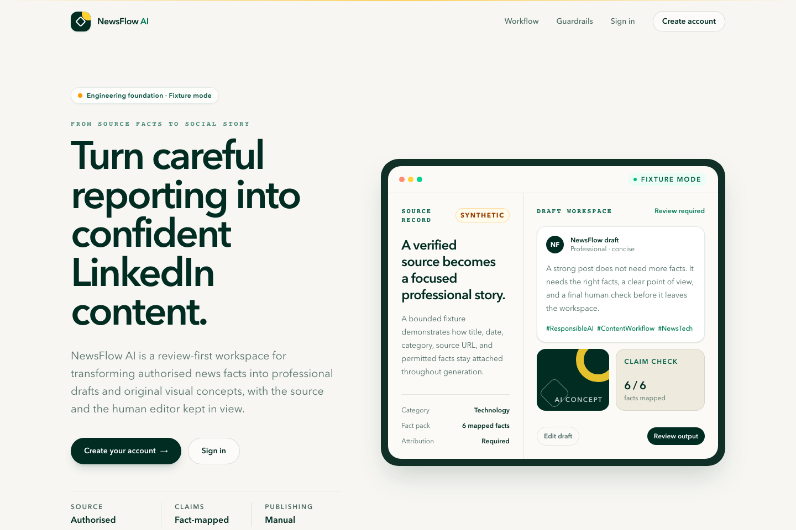
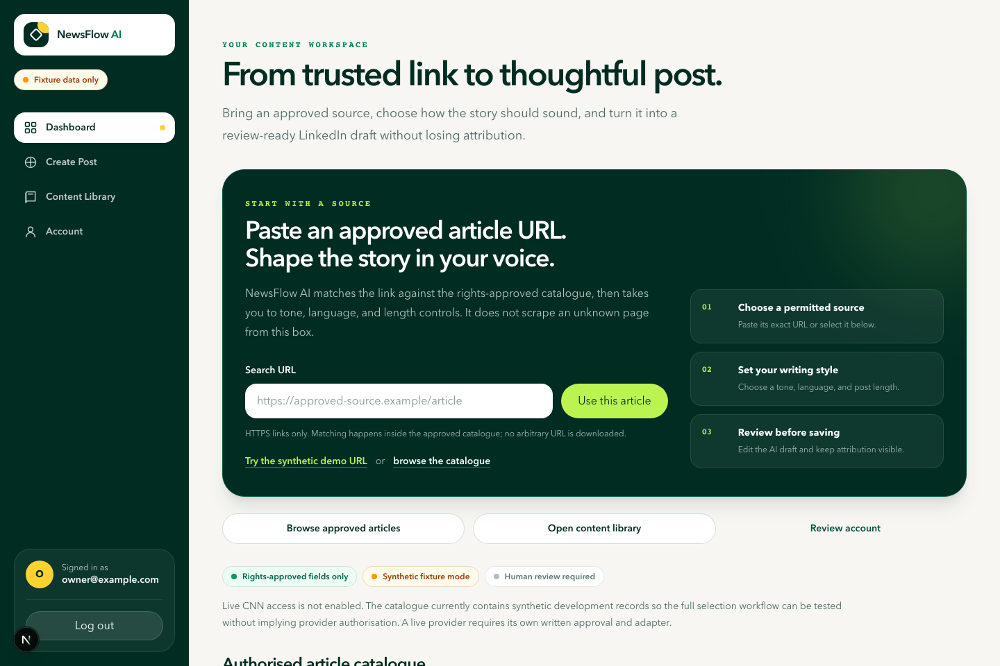
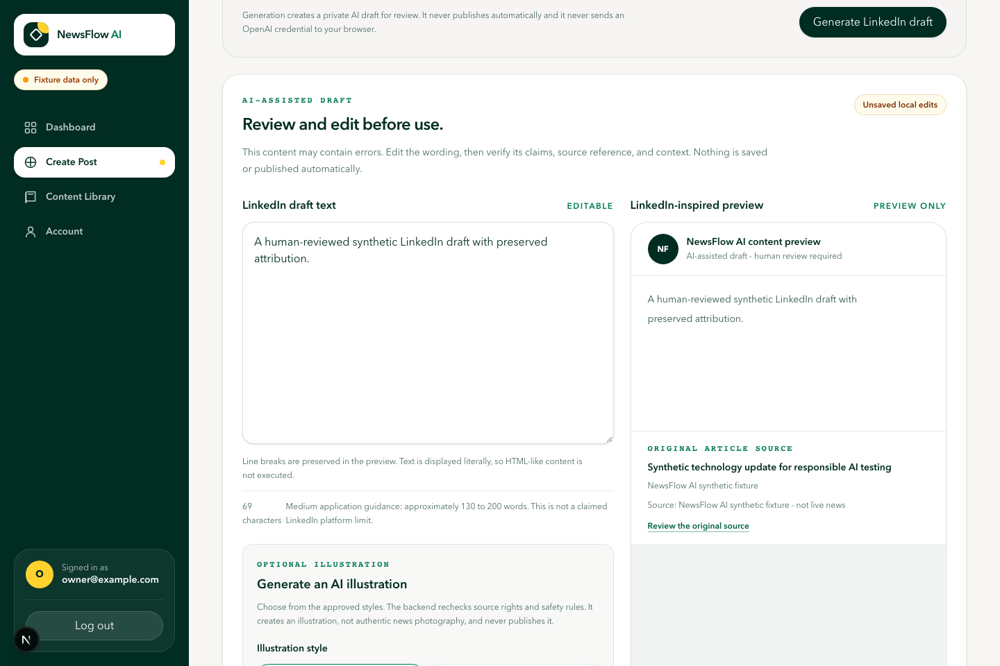

# NewsFlow AI Portfolio Case Study

## Project overview

NewsFlow AI is a full-stack, review-first content workspace that turns permitted news facts into editable LinkedIn drafts and original conceptual illustrations.

I designed and built the project as an end-to-end software and data engineering portfolio application. It includes a responsive Next.js interface, a typed FastAPI backend, a normalised PostgreSQL data model, article ingestion and provenance pipelines, backend-only OpenAI service boundaries, private saved content, Docker packaging, CI, and comprehensive automated tests.

- **GitHub:** [github.com/mashoodogunbiyi/newsflow-ai](https://github.com/mashoodogunbiyi/newsflow-ai)
- **Technical report:** [NewsFlow AI Technical Report](technical-report.md)
- **Demonstration:** [Repeatable local demonstration package](demonstration/README.md)
- **Status:** Controlled local demonstration ready; live CNN and public production release remain No-Go



## Problem

Generating a social post from news is not just a text-generation problem. The product must also answer:

- Is the source permitted for storage, display and AI processing?
- Can generated claims be traced to the supplied information?
- Could an illustration be mistaken for authentic news photography?
- Can one user access another user's saved drafts or images?
- What happens when OpenAI, PostgreSQL, storage or the network fails?

The original brief proposed CNN information. My research found no confirmed authorisation for the intended live use, so I recorded a No-Go architecture decision instead of scraping content or hiding the risk.

## Solution

I created a provider-neutral application that uses original synthetic news fixtures for development and demonstration. The same boundary can support a future authorised provider without coupling the rest of the system to CNN.

The user journey is:

1. register or sign in;
2. browse approved article metadata or paste an exact approved URL;
3. review source attribution and current generation permission;
4. choose tone, language and length;
5. generate a grounded draft;
6. edit it and review a LinkedIn-inspired preview;
7. generate or regenerate an AI illustration;
8. save the selected text and image privately;
9. reopen versioned content from a personal library; and
10. copy text, download the image, or delete the saved draft.

Nothing is published automatically. Human review is mandatory.

## Technology stack

- **Frontend:** Next.js 16, React 19, TypeScript and Tailwind CSS 4.
- **Backend:** Python, FastAPI and Pydantic.
- **Database:** PostgreSQL 16, SQLAlchemy and Alembic.
- **AI integration:** Official OpenAI Python SDK behind backend text and image interfaces.
- **Testing:** Pytest, HTTPX, Vitest, React Testing Library, Playwright and axe-core.
- **Delivery:** Docker, Docker Compose, GitHub Actions, Git and Jira.

## Architecture

The browser talks to Next.js pages and same-origin route handlers. FastAPI is the authoritative security and business-logic boundary. PostgreSQL stores accounts, hashed sessions, article metadata, provenance, rights, generated content, versions and audit evidence. Generated image bytes are kept in private storage and are returned only through owner-authorised endpoints.

External services are isolated behind adapters. The article factory allows only synthetic fixture mode. OpenAI calls remain backend-only, so API keys are never sent to the browser and routine tests can use deterministic doubles.

[View the complete architecture diagrams](architecture/system-architecture.md).

## Key features

- Secure registration and server-managed cookie sessions.
- CSRF protection and owner-scoped object authorisation.
- Article validation, normalisation, sanitisation and deduplication.
- Immutable provenance and versioned content-rights records.
- Exact approved-URL selection without arbitrary web scraping.
- Configurable LinkedIn generation in three tones, three languages and three lengths.
- Prompt separation, factual-grounding checks and source attribution.
- Sensitive-news image policy and AI-generated illustration disclosure.
- Private image validation, storage, preview and download.
- Draft editing, preview, saving, optimistic updates and immutable history.
- Copy, download, deletion, retention and recovery workflows.
- Docker packaging, migrations, health checks and CI quality gates.





## Data engineering work

The project demonstrates:

- a typed source-provider interface;
- a validate-normalise-sanitise pipeline;
- stable identity and canonical URL deduplication;
- immutable retrieval provenance;
- versioned storage, display, AI and redistribution permissions;
- bounded synchronisation and checkpoint evidence;
- a normalised PostgreSQL model with UUIDs, constraints, indexes and transactions;
- Alembic migrations and repeatable synthetic seed data; and
- deterministic integration tests against disposable PostgreSQL databases.

Fifteen schema revisions cover the journey from initial users and articles through secure sessions, rights, generation, images, saved content, version history, deletion and retention.

## Software engineering work

The codebase uses route, service and repository layers with strict Pydantic contracts. Next.js route handlers forward only approved cookies and headers. FastAPI applies current rights, authentication, authorisation, limits and ownership regardless of frontend behaviour.

I used feature branches, pull requests, Jira epics and tasks, Markdown evidence, CI checks, and repeatable local commands to build project-management experience alongside implementation experience.

## AI integration and safety

Text and image generation are implemented through backend OpenAI interfaces. Prompt construction uses only permitted source fields and separates trusted instructions from untrusted article data. Output validation checks schema, source reference, length and factual grounding.

Image policy rejects deceptive or unsupported requests before a provider call. Returned image bytes are decoded, bounded, stripped of unwanted metadata, integrity checked and stored privately. The interface identifies generated images as AI illustrations.

Routine tests and the portfolio demonstration use mocked provider responses. This avoids real credentials, paid calls and misleading claims about live output.

## Engineering challenges

### Source permission

No authorised CNN method was confirmed. I solved this by recording an explicit No-Go, implementing a fail-closed provider factory and using original synthetic fixtures. This allowed engineering work to continue without unauthorised scraping.

### Data lineage and changing rights

Stable article identity, changing snapshots, retrieval events and changing permissions could not safely live in one row. I separated them into related, versioned records with database constraints and point-of-use rights checks.

### Cross-stack authentication

Next.js and FastAPI needed a secure cookie flow. I used server-managed sessions, hashed token storage, HTTP-only cookies, CSRF proof and backend owner-scoped queries.

### AI reliability

Prompting alone could not guarantee factual output. I combined strict schemas, claim evidence, deterministic evaluation, review warnings, blocking rules and mandatory human review.

### Database and image consistency

PostgreSQL and file storage cannot share one transaction. I added validation-before-storage, compensating deletion, cleanup evidence and reconciliation behaviour.

### Reliable portfolio demonstration

Live providers could make a demonstration unpredictable. I added a loopback mock API, synthetic account, one-command launcher, automated browser journey, safe screenshots and a documented fallback plan.

## Testing, security, and measurable results

Current verified evidence includes:

- **489 backend tests passed** on 6 November 2026; 16 destructive PostgreSQL tests remained deliberately gated and one optional live-model test was deselected.
- **173 frontend tests passed** across 36 files.
- **13 Playwright scenarios passed**, covering authentication, approved URL selection, text and image generation, editing, saving, reopening, copying, download, deletion, failure states, responsive accessibility and cross-user isolation.
- The latest recorded CI baseline measured **79.10 percent branch-aware backend coverage**, above the enforced 75 percent floor.
- The AI safety baseline evaluated **10 grounding cases, 7 image cases and 12 claims**; every predefined deterministic threshold reached 100 percent.
- Local performance guardrails recorded p95 results below 7 ms for the measured in-process fake-backed workloads. These are regression baselines, not production latency claims.
- Docker clean-build verification applied **15 Alembic revisions**, passed health checks and preserved a database marker across restart.

Security controls include Argon2id, HTTP-only sessions, CSRF, object-level authorisation, input bounds, exact CORS, security headers, safe errors, secret scanning, dependency auditing and a STRIDE threat model.

## Results

The project produced a working local application and a repeatable demonstration of the complete synthetic article-to-content workflow. More importantly, it produced a traceable engineering system around that workflow: source governance, lineage, rights, security, private storage, test isolation, failure recovery, version history and honest release gates.

The application is ready for a controlled local portfolio demonstration. It is not presented as a deployed production product, live CNN integration, or automatic LinkedIn publisher.

## Lessons learned

- Access to a website is not the same as permission to reuse its content.
- Architecture decisions should make blocked functionality explicit and fail closed.
- Database constraints and owner-scoped queries are stronger than UI-only rules.
- External AI should be treated as an unreliable provider, not the source of truth.
- Deterministic fakes are essential for fast, affordable and repeatable CI.
- Data lineage and rights metadata should be designed with the core schema, not added later.
- Partial failure between database and object storage needs compensation and reconciliation.
- Good portfolio documentation must distinguish implemented, mocked, proposed and blocked features.

## Known limitations and next steps

- Obtain written source permission or select another authorised provider.
- Replace local image storage with encrypted private object storage.
- Add managed hosting, secrets, HTTPS, monitoring, shared rate limiting, backups and restore testing.
- Complete representative UAT and human screen-reader review.
- Implement a secure password-reset workflow.
- Expand multilingual and high-risk AI evaluation datasets.
- Select a software licence.

## GitHub repository and demonstration

- [GitHub repository](https://github.com/mashoodogunbiyi/newsflow-ai)
- [Technical report](technical-report.md)
- [System architecture](architecture/system-architecture.md)
- [Testing evidence](testing.md)
- [Demonstration instructions](demonstration/README.md)
- [Presenter script](demonstration/demo-script.md)

Run the deterministic local demonstration without CNN or OpenAI calls:

```bash
cd apps/web
npm ci
npm run demo
```

The demonstration uses synthetic identities, a fictional article and mocked AI responses.

## CV-ready summary

- Built a full-stack AI-assisted content platform using Python, FastAPI, Next.js, TypeScript, PostgreSQL, OpenAI service interfaces and Docker.
- Designed an article data pipeline covering validation, normalisation, deduplication, provenance, rights metadata and bounded synchronisation.
- Implemented secure server-managed authentication, CSRF protection and object-level authorisation for private drafts and images.
- Developed grounded text and safe image-generation workflows with output validation, human review, usage controls and deterministic provider mocks.
- Created 15 Alembic migrations plus unit, integration, browser, accessibility, security, reliability and CI quality checks.
- Managed the project through Jira epics and tasks, Git feature branches, pull requests, acceptance evidence and release documentation.

