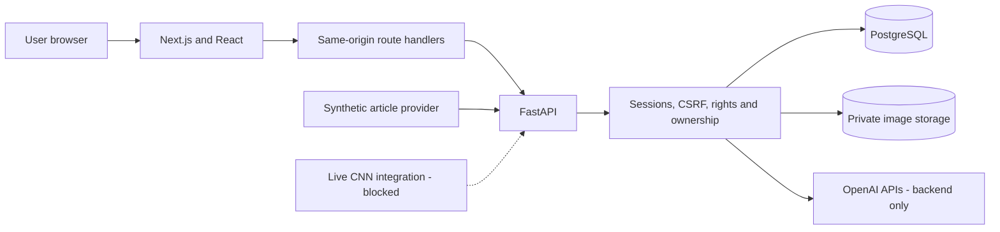
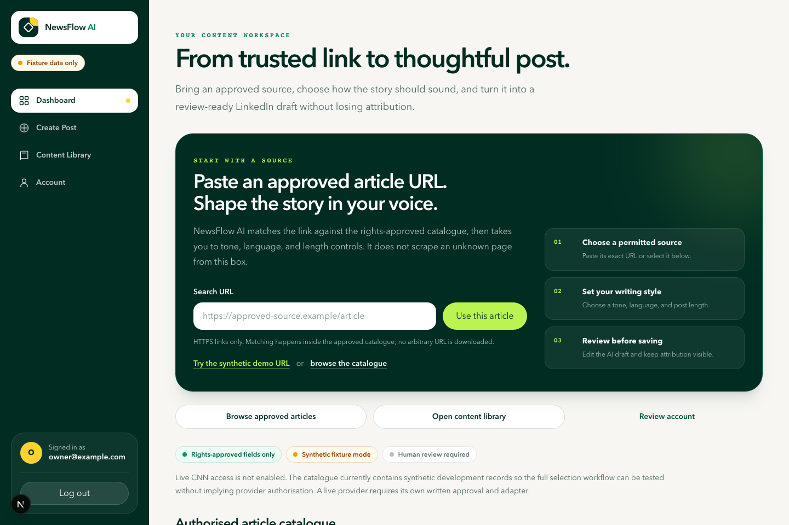
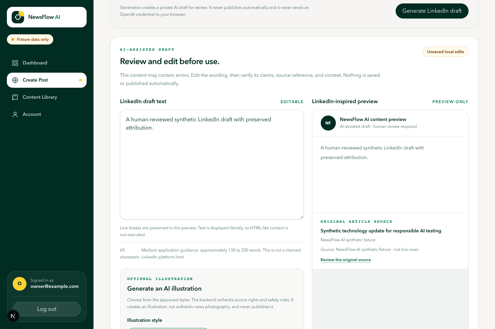
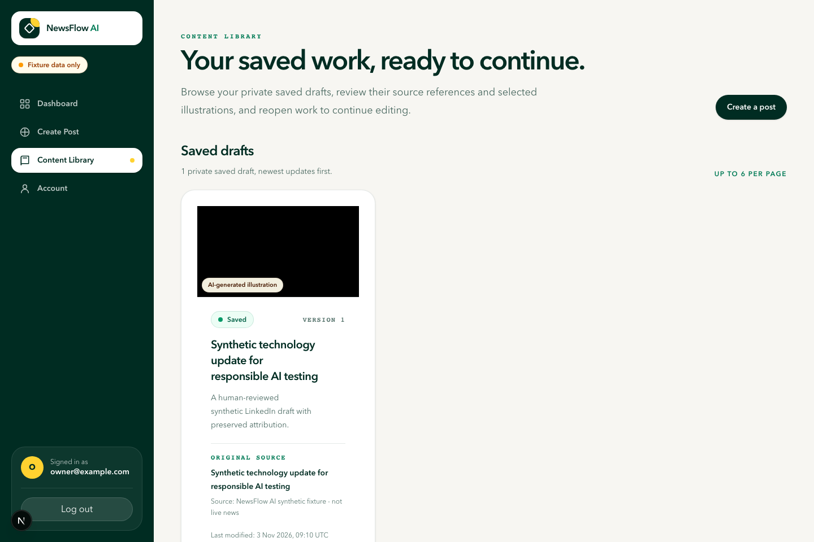

# NewsFlow AI Technical Report

## Document control

| Field | Value |
| --- | --- |
| Project | NewsFlow AI |
| Jira issue | NFA-89 |
| Report version | 1.0 |
| Report date | 6 November 2026 |
| Author and project owner | Mashood Ogunbiyi |
| Repository | [github.com/mashoodogunbiyi/newsflow-ai](https://github.com/mashoodogunbiyi/newsflow-ai) |
| Current delivery decision | Conditional Go for a controlled local synthetic-data demonstration |
| Public production release | No-Go |
| Live CNN integration | No-Go - not authorised |

## 1. Executive summary

NewsFlow AI is a full-stack, review-first application that turns permitted news facts into editable LinkedIn drafts and original conceptual illustrations. It combines a Next.js and React frontend, a FastAPI backend, PostgreSQL, private image storage, Docker, and backend-only OpenAI service boundaries.

The engineering problem was broader than generating text. The application also needed to preserve source provenance, enforce content rights, prevent cross-user access, ground generated claims in permitted source information, label AI illustrations, handle provider failures safely, and keep a human in control of every export decision.

The original product brief proposed CNN information as the news source. The rights investigation found no authorisation for live CNN retrieval or reuse, so ADR-001 recorded a No-Go decision. The system was therefore implemented with a provider-neutral boundary and original synthetic fixtures. This preserves the technical design and demonstration value without scraping or misrepresenting live CNN content.

The implemented local application supports registration, secure sessions, article discovery, exact approved-URL selection, configurable text generation, editing, image generation and regeneration, preview, private persistence, version history, copying, downloading, and deletion. Routine tests replace external providers with deterministic doubles, while live OpenAI calls remain an optional backend configuration rather than a test dependency.

On 6 November 2026, the normal deterministic backend run passed 489 tests, the frontend run passed 173 tests across 36 files, and all 13 Playwright Chromium scenarios passed. The NFA-78 evaluation passed its predefined thresholds across 10 grounding cases, 7 image-safety cases, and 12 claims. These are local and synthetic test results, not evidence of production performance, complete factual accuracy, or live-source permission.

## 2. Project background

NewsFlow AI began as a proposal to help users transform news information into professional LinkedIn content. The intended workflow was to discover an article, select it, generate a draft and illustration, edit the result, preview it, and save or export it.

Early requirements analysis showed that this workflow crosses several engineering and governance boundaries:

- externally sourced news may have access, storage, reuse, attribution, and AI-processing restrictions;
- generative models can invent facts, quotations, statistics, or misleading imagery;
- user drafts, sessions, and generated files are private data;
- text and image provider calls cost money and may fail or time out;
- database and object storage operations cannot share one transaction; and
- a portfolio demonstration must not claim that proposed hosting or unauthorised integrations are complete.

The project was organised in Jira using epics, tasks, feature branches, pull requests, and evidence comments. The repository records requirements, architecture decisions, implementation documentation, automated tests, deployment preparation, and demonstration material alongside the source code.

## 3. Problem statement

The core problem is:

> How can a user create useful professional social content from permitted news information while preserving source traceability, user ownership, AI safety, and human review?

A naive solution would send arbitrary article text to a model and return the result. That would not answer whether the content was authorised, whether claims were grounded, whether generated images could mislead, who owned saved results, or how failures should be recovered.

NewsFlow AI addresses the problem through explicit source contracts, provenance and rights records, backend-only AI adapters, deterministic validation, private storage, owner-scoped queries, safe error handling, and deliberate user-controlled export.

## 4. Project objectives

The project objectives were to:

1. create a responsive web interface for article discovery and content creation;
2. provide a typed FastAPI API for authentication, articles, generation, images, and saved content;
3. model users, sessions, articles, rights, provenance, generations, images, and saved versions in PostgreSQL;
4. isolate article sources behind a reusable provider interface;
5. integrate OpenAI text and image services through server-side interfaces;
6. ground output in permitted source facts and retain attribution;
7. protect private content with authentication, CSRF controls, and object-level authorisation;
8. make local development reproducible with Docker, Alembic, environment templates, and health checks;
9. test the system without requiring live CNN access or paid OpenAI calls; and
10. produce portfolio-quality technical, operational, and demonstration documentation.

## 5. Requirements analysis

### 5.1 Functional requirements

The baseline requirements are maintained in [NFA-3](jira/NFA-3.md). The implemented functional areas are:

| Area | Implemented behaviour |
| --- | --- |
| Accounts | Registration, Argon2id password hashing, login, logout, session expiry, authenticated-user retrieval |
| Article catalogue | Authenticated listing, filtering, pagination, exact approved-URL resolution, detail and generation availability |
| Ingestion | Provider interface, synthetic adapter, validation, sanitisation, identity, deduplication, provenance, rights, synchronisation evidence |
| LinkedIn generation | Professional, conversational, and analytical tones; English, French, and Spanish; short, medium, and long output; source attribution and review states |
| Image generation | Safe prompt composition, sensitive-news policy, generation, regeneration, validation, private storage, selection and delivery |
| Editing and preview | Editable text, character feedback, unsaved-change protection, LinkedIn-inspired preview, attribution and AI disclosure |
| Content management | Save, list, retrieve, update, immutable history, restore, copy, download, delete, retention and cleanup evidence |
| Operations | Health and readiness checks, structured logging, monitoring records, limits, idempotency, safe errors and recovery controls |

The live CNN discovery requirement is intentionally not implemented. The approved alternative is fixture-based development through the same provider contract. Direct LinkedIn publishing is outside scope; users copy text or download an image and remain responsible for final review and publication.

### 5.2 Non-functional requirements

The main non-functional requirements and implementation responses are:

| Quality | Response |
| --- | --- |
| Security | Server-side secrets, Argon2id, hashed session values, HTTP-only cookies, CSRF, bounded inputs, security headers, owner-scoped queries and secret scanning |
| Rights and privacy | Fail-closed source selection, versioned rights, data minimisation, synthetic routine tests, private image delivery and documented retention |
| Reliability | Transactions, idempotency, bounded retries, controlled timeouts, compensation, reconciliation and original-content preservation |
| Performance | Cursor pagination, bounded payloads, indexes, request-count checks, bundle budgets and synthetic local latency guardrails |
| Accessibility | Keyboard operation, focus indicators, labels, status announcements, responsive viewports, reduced motion and automated axe checks |
| Maintainability | Route-service-repository separation, provider interfaces, typed contracts, migrations, reusable components and focused documentation |
| Testability | Deterministic fakes, synthetic fixtures, disposable PostgreSQL databases, unit, integration, browser and documentation checks |
| Deployability | Multi-stage Dockerfiles, Compose health ordering, one-shot migrations, safe environment template and setup guides |

Some non-functional requirements remain release gates. In particular, representative human screen-reader review, human UAT, managed secrets, production storage, shared rate limiting, monitoring, backup and restore evidence are not complete.

## 6. System architecture

The browser renders the interface but does not receive database credentials, provider keys, session hashes, or private storage keys. Next.js route handlers provide a narrow same-origin gateway. FastAPI remains authoritative for validation, authentication, authorisation, rights, limits, business rules, and persistence.

The backend uses route, service, and repository layers. Provider adapters isolate external systems, which allows routine tests to replace OpenAI and article providers with deterministic doubles. PostgreSQL is the system of record for structured metadata and relationships; generated image bytes are stored separately and delivered only after an owner check.

Detailed maintainable diagrams are available in the [system architecture](architecture/system-architecture.md), [data-flow documentation](architecture/data-flow.md), and [architecture decision record](architecture/architecture-decisions.md).

## 7. Technology stack

| Layer | Technology | Reason for selection |
| --- | --- | --- |
| Frontend | Next.js 16, React 19, TypeScript, Tailwind CSS 4 | Typed components, server rendering, protected routes, route handlers and responsive design |
| Backend | Python, FastAPI, Pydantic | Typed HTTP contracts, automatic OpenAPI, dependency injection and asynchronous service boundaries |
| Persistence | PostgreSQL 16, SQLAlchemy, Alembic | Relational integrity, transactions, indexing, migrations and explicit ownership relationships |
| AI | Official OpenAI Python SDK | Backend-only structured text and image integration with testable adapters |
| Image handling | Pillow and private storage adapter | Format, dimension, metadata, pixel and digest validation before persistence |
| Quality | Pytest, HTTPX, Ruff, Vitest, React Testing Library, Playwright, axe-core | Unit, API, integration, browser, accessibility and static-quality coverage |
| Packaging | Docker and Docker Compose | Reproducible frontend, backend, migration and PostgreSQL services |
| Delivery workflow | Git, GitHub, GitHub Actions and Jira | Branch review, CI evidence, task traceability and project-management practice |

## 8. Database design

The PostgreSQL design uses UUID primary keys, foreign keys, uniqueness rules, check constraints, timestamps, and targeted indexes. Fifteen version-controlled Alembic revisions evolve the system from the initial schema through secure sessions, provenance, synchronisation, generation, grounding, images, saved content, history, deletion, and retention.

The main data groups are:

- **Identity:** users and revocable sessions.
- **Source governance:** source profiles, stable articles, immutable snapshots, provenance events and versioned rights.
- **Text generation:** generated posts, generation runs, source facts, post versions, claims, claim sources, usage and audit evidence.
- **Images:** generation metadata, parent-child regeneration lineage, safety status, digest, storage key and selected-image relationships.
- **Content library:** owner-scoped saved drafts, current optimistic version and immutable history.
- **Operations:** sync jobs, checkpoints, deletion work and monitoring evidence.

The design applies Third Normal Form where separation improves integrity. For example, stable article identity is separate from changing snapshots; source permissions are versioned rather than overwritten; image bytes are not stored in relational rows; and immutable history is separate from the current saved-draft state.

Owner IDs are part of private-content relationships and repository predicates. A differently owned UUID is treated like a missing resource so an attacker cannot confirm that another user's record exists. The complete schema and ERD are documented in [NFA-20](jira/NFA-20.md).

## 9. Article ingestion, normalisation, and provenance

The `NewsProvider` interface returns typed, bounded pages. The provider factory currently creates only the synthetic fixture provider and raises a source-not-authorised error for any unsupported mode. The disabled CNN adapter makes no network request.

The ingestion pipeline performs these stages:

1. fetch a bounded provider page;
2. validate required fields and the source contract;
3. normalise timestamps, categories, URLs and optional text;
4. sanitise unsafe markup and control characters;
5. derive stable identity from provider ID and canonical URL;
6. deduplicate existing articles while preserving retrieval evidence;
7. persist snapshots, provenance and a versioned rights decision; and
8. record sync counts, checkpoints, duration and safe failure categories.

Provenance answers where a record came from. Rights metadata answers which storage, display, AI-processing, derivative, redistribution, attribution and retention operations are permitted. The rights service denies missing, unverified, expired, revoked, or disabled-source records. Rights are checked again at the point of display or generation rather than assumed from earlier ingestion.

The source data contract is documented in [NFA-6](jira/NFA-6.md), and the implemented rights model is documented in [article-provenance-and-rights.md](article-provenance-and-rights.md).

## 10. AI text generation

An authenticated user selects a permitted article and chooses tone, language, and length. FastAPI then:

1. resolves the active session and article;
2. rechecks current display and AI-generation rights;
3. applies per-user usage, concurrency, rate and idempotency controls;
4. builds a versioned prompt from allowed article fields;
5. separates trusted instructions from untrusted source content;
6. calls the backend OpenAI text interface;
7. validates the response schema, length, source reference and claim grounding; and
8. stores the private draft, usage metadata and content-free audit evidence.

The output is returned as an editable draft with attribution, grounding status, warnings and an explicit `review_required` flag. The application never publishes it automatically. Provider timeouts, rate limits, invalid output, insufficient context, rights failures, and uncertain duplicate requests produce controlled states instead of false success.

Routine tests inject deterministic OpenAI doubles. A live request requires a server-side `OPENAI_API_KEY`, an approved model configuration, provider availability, and applicable deployment approval.

## 11. AI image generation

Image generation begins with an owned generated draft and its rights-approved article context. A prompt composer creates a conceptual illustration request while prohibiting unsupported event details, logos, watermarks, authentic-news presentation, and unsafe attempts to override policy.

Sensitive-news policy can allow, restrict, require review, or reject a request before a provider call. Returned bytes must pass MIME, decoding, size, dimension, pixel, metadata, and digest checks. Valid bytes are stored privately under an opaque key, while PostgreSQL stores ownership, lineage, model, safety, validation and integrity metadata.

Regeneration creates an immutable alternative linked to its parent. Failure preserves the original. Preview and download endpoints recheck ownership and return private no-store responses without exposing a filesystem path or storage key. The current storage adapter is suitable only for local development and tests; production private object storage remains a release requirement.

## 12. Frontend implementation

The frontend provides public home, registration and login pages plus a protected workspace containing dashboard, generation, library and account views.

The main workflow lets a user:

- paste an exact approved article URL or browse the catalogue;
- inspect source information and attribution;
- choose tone, language and length;
- generate and edit a draft;
- preview current text and selected illustration;
- generate and compare image alternatives;
- save and reopen private content;
- review version information;
- copy the current edited text;
- download the selected illustration; and
- confirm deletion.

Loading, empty, failure, retry, unsaved-change, success and accessibility states are explicit. Client-side checks improve usability, while the backend remains authoritative. Responsive and browser checks cover mobile, tablet and desktop viewports.

## 13. Authentication, authorisation, and security

Registration validates email and password rules, hashes passwords with Argon2id, and relies on a database uniqueness constraint to prevent duplicate accounts. Login verifies the hash and creates random session and CSRF values. Raw values are sent as cookies; PostgreSQL stores only SHA-256 hashes.

The session cookie is HTTP-only and becomes Secure outside local development. State-changing requests require both an active session and matching CSRF proof. Logout revokes the server-managed session, and absolute expiry prevents indefinite use.

Object-level authorisation is applied in repository queries for drafts, versions, images, export, and deletion. Missing and differently owned private resources return the same non-disclosing response.

Additional controls include bounded request bodies, strict content types, validated provider URLs, security headers, exact CORS configuration, environment-based secrets, rate and usage limits, no-store private responses, structured content-free logging, secret scanning, dependency auditing, and a STRIDE threat model.

Production security is not claimed. HTTPS edge configuration, managed secrets, production database and storage hardening, shared abuse controls, backup and restore, audit-log access, and incident operations remain open gates.

## 14. Content persistence and lifecycle

Saving verifies that the generated draft and optional selected image belong to the authenticated user. One PostgreSQL transaction creates the current saved record and an immutable initial history entry. An idempotency key prevents an accidental duplicate save.

Updates use optimistic concurrency. A stale expected version returns a conflict instead of silently overwriting newer content. Restoring a historical version appends a new version rather than rewriting history.

Listing is owner scoped and paginated. Image export checks owner metadata before reading private bytes. Deletion removes active access immediately, redacts content where required, removes relational history according to policy, and records retryable private-object cleanup. Database and storage cannot share a transaction, so compensation and reconciliation handle partial storage failures.

## 15. Testing and evaluation

The strategy combines:

- fast unit tests for models, policies, services and components;
- API and contract tests for routes, cookies, CSRF, validation and errors;
- safety-gated integration tests against explicitly named disposable PostgreSQL databases;
- migration, rollback and repeatable-seed tests;
- temporary private-storage tests;
- deterministic OpenAI and provider doubles;
- Playwright browser journeys;
- accessibility, responsive, performance, bundle and recovery checks;
- documentation contracts, secret scanning and dependency audits; and
- a GitHub Actions workflow that repeats the required quality gates.

### 15.1 Current verified results

| Evidence | Result | Qualification |
| --- | --- | --- |
| Backend deterministic suite, 6 November 2026 | 489 passed, 16 safety-gated tests skipped, 1 optional live-model test deselected | Local run; no CNN or OpenAI request |
| Frontend component suite, 6 November 2026 | 173 passed across 36 files | Local deterministic run |
| Playwright Chromium suite, 6 November 2026 | 13 passed | Synthetic API, mocked generation and production Next.js build |
| Latest recorded CI coverage baseline | 79.10 percent branch-aware backend coverage | Above the enforced 75 percent floor; recorded during NFA-80, not remeasured for this report |
| NFA-78 AI evaluation | 9 evaluation tests passed; 10 grounding cases, 7 image cases and 12 claims met every predefined threshold | Curated synthetic baseline; human review still required |
| NFA-80 in-process p95 guardrails | 1.217 ms article list, 1.437 ms saved drafts, 1.012 ms one MiB image, 6.422 ms for 24 article requests with 8 workers | Local fakes, not production latency |
| Frontend production bundle baseline | 42 JavaScript chunks, 1,041,667 raw bytes and 326,988 gzip bytes | NFA-80 recorded baseline |
| Docker lifecycle | Clean build, migrations through revision 0015, health checks, restart and persistence passed | Controlled local environment |

The complete command history and limitations are maintained in [testing.md](testing.md). [GitHub Actions run 104](https://github.com/mashoodogunbiyi/newsflow-ai/actions/runs/41945748020) is the latest quality run explicitly recorded in the repository documentation at the time of this report.

### 15.2 AI grounding evaluation

The NFA-78 baseline includes supported, insufficient, ambiguous, conflicting, sensitive and prompt-injection cases. It detected an invented statistic, invented quotation, source mismatch and misleading certainty. Image cases covered allowed conceptual work, restricted realistic conflict, fake disaster evidence, identifiable-person election content and a safety-override attempt.

All predefined metrics reached 100 percent in this curated dataset, including safe-claim evidence, unsafe-claim detection, source-reference handling, prompt-injection resistance, image-policy decisions, restricted-image rejection and AI labelling. This means the deterministic policy matched its reviewed fixtures. It does not mean a model is always factual or safe, and it does not remove human review.

## 16. Key engineering decisions

| Decision | Reason and result |
| --- | --- |
| Provider-neutral article boundary | Development could continue with synthetic data while unauthorised live CNN access remained blocked |
| FastAPI as authoritative boundary | Security and business rules remain server enforced even when frontend code changes |
| Server-managed cookie sessions | Central revocation and HTTP-only cookies avoid browser-stored bearer secrets |
| PostgreSQL system of record | Transactions and relational constraints protect ownership, lineage, rights and versions |
| Rights checks at point of use | Stored data cannot bypass a later restriction, expiry or revocation |
| Backend-only OpenAI adapters | Keys stay server-side and deterministic test doubles replace live calls in routine CI |
| Private image bytes outside PostgreSQL | Relational metadata remains queryable while bytes stay behind owner-authorised delivery |
| Human review and no automatic publishing | AI output remains an editable draft instead of an unreviewed public claim |
| Versioned migrations and Docker packaging | Schema and services can be reproduced locally and in CI |
| Gated production architecture | Documentation distinguishes implemented local controls from proposed hosting controls |

## 17. Challenges and solutions

### 17.1 Source rights blocked the planned live integration

The first challenge was not technical access but permission. No official authorised method had been confirmed for the intended CNN use. The solution was to record a clear No-Go decision, create a provider interface, fail closed, and continue with original synthetic fixtures. This avoided scraping while preserving the architecture and testability of the ingestion pipeline.

### 17.2 Preserving identity, history, and changing permissions

A single article table could not represent stable identity, changing metadata, repeated retrievals and changing rights safely. The solution separated articles, snapshots, provenance events and rights versions, with constraints and transactions linking the current permission state to immutable evidence.

### 17.3 Securing a frontend-backend session flow

Cookie authentication required coordination between Next.js route handlers and FastAPI. The solution used selected-cookie forwarding, HTTP-only sessions, CSRF proof for mutations, absolute expiry and backend owner checks. Browser code never became the source of authority.

### 17.4 Preventing AI output from being treated as verified news

Prompting alone could not guarantee grounding. The solution combined versioned prompt construction, strict request and response schemas, fact references, deterministic validation, warnings and blocking decisions, source attribution, AI image policy and mandatory human review.

### 17.5 Keeping database and image storage consistent

PostgreSQL and file storage cannot commit atomically. The solution validates bytes before persistence, uses database transactions where possible, performs compensating deletion after partial failures, records cleanup work, and reconciles uncertain deletion states.

### 17.6 Making the demonstration reliable without hiding provider dependence

A live provider or network failure could disrupt a portfolio presentation. The solution added a loopback-only deterministic mock API, synthetic account, one `npm run demo` command, repeatable screenshots, a browser rehearsal, and a fallback plan. The presenter must identify mocked output rather than describing it as live OpenAI output.

## 18. Measurable outcomes

- Implemented a complete local article-to-draft-to-image-to-library workflow.
- Created 15 Alembic schema revisions covering the data lifecycle.
- Passed 489 deterministic backend tests in the NFA-89 verification run.
- Passed 173 frontend tests and 13 browser scenarios in the current demonstration baseline.
- Maintained an enforced 75 percent backend coverage floor; the latest recorded CI baseline measured 79.10 percent.
- Met all predefined NFA-78 metrics across 10 grounding cases, 7 image-safety cases and 12 claims.
- Verified responsive browser behaviour at 375 x 812, 768 x 1024 and 1440 x 900 viewports in the NFA-80 baseline.
- Produced four repeatable screenshots containing synthetic data only.
- Built a clean Docker lifecycle with PostgreSQL persistence, one-shot migrations and service health ordering.
- Preserved a No-Go boundary for live CNN and public production release.

## 19. Known limitations

- Live CNN access is not authorised or implemented.
- Exact pasted URLs must already exist in the approved catalogue; arbitrary web pages are not scraped.
- Synthetic fixtures and deterministic evaluations do not represent every real-world news ambiguity.
- OpenAI output can still contain mistakes and requires human review.
- Live generation depends on an approved key, model access, provider availability and credit.
- The implemented image-storage adapter is local-only and is rejected for production.
- The application has not been deployed to a production hosting platform.
- Managed secrets, edge controls, production monitoring, backups and tested restore are not implemented.
- Representative human UAT and human screen-reader review remain pending.
- A forgotten-password workflow is planned but not implemented.
- The application does not publish directly to LinkedIn.
- No software licence has been selected.

## 20. Future improvements

Priority improvements are to:

1. obtain written source authorisation or integrate a different approved news provider;
2. implement encrypted private object storage with inventory and reconciliation;
3. select an approved hosting platform, managed PostgreSQL and secret manager;
4. configure HTTPS, trusted proxies, shared rate limiting, spending alerts and incident monitoring;
5. implement and test backup and restore procedures;
6. complete representative UAT and assistive-technology review;
7. design a secure password-reset flow with identity verification and abuse controls;
8. expand multilingual, ambiguity and high-risk AI evaluation datasets; and
9. select a repository licence and complete final release governance.

## 21. Conclusion

NewsFlow AI demonstrates full-stack software engineering, data modelling, data-pipeline design, API integration, applied AI controls, security, testing, Docker packaging, CI and project management. Its most important result is not merely that it can produce a draft. It shows how generation can be placed inside a traceable, rights-aware, owner-scoped and human-reviewed workflow.

The system is ready for a controlled local demonstration using synthetic data and mocked providers. It is not ready for public production use or live CNN integration. Keeping those boundaries explicit is part of the engineering outcome, not an omission from it.

## 22. Technical claim references

| Claim area | Primary evidence |
| --- | --- |
| Requirements and scope | [NFA-3](jira/NFA-3.md) and [project plan](../PROJECT_PLAN.md) |
| Source authorisation and decision | [NFA-5](jira/NFA-5.md) and [ADR-001](jira/NFA-8.md) |
| Source contract and provenance | [NFA-6](jira/NFA-6.md) and [rights documentation](article-provenance-and-rights.md) |
| Database and ownership | [NFA-20 schema](jira/NFA-20.md) and [authorisation guide](authorization.md) |
| Architecture and data flows | [Architecture package](architecture/system-architecture.md) and [data flows](architecture/data-flow.md) |
| AI generation and safety | [AI architecture](architecture/ai-generation-architecture.md), [grounding evaluation](ai-grounding-content-safety-evaluation.md) and [image safety](image-safety-policy.md) |
| Security | [Threat model](security-threat-model.md) and [API security review](api-security.md) |
| Testing and measurements | [Testing guide](testing.md), [performance report](performance-accessibility-verification.md) and [release review](release-readiness-quality-signoff.md) |
| Demonstration | [Demonstration package](demonstration/README.md) and [evidence record](demonstration/evidence.md) |

